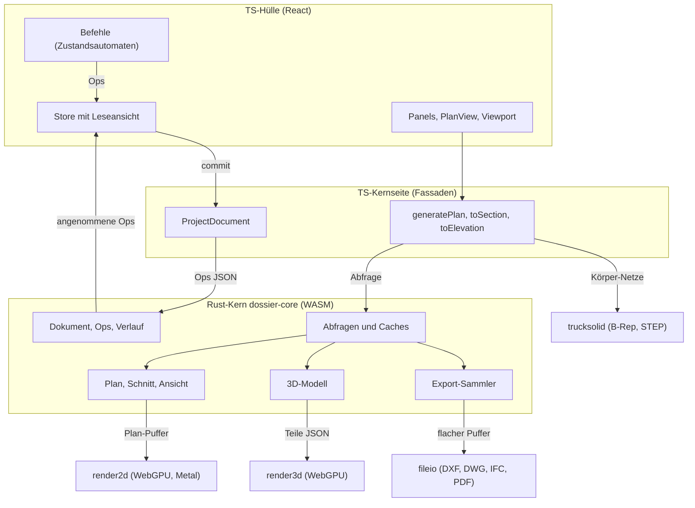

# Dossier: Architektur für Entwicklerinnen und Entwickler

Dieses Dokument erklärt, wie die Teile von Dossier zusammenspielen. Es richtet sich an erfahrene
Entwicklerinnen ohne Vorwissen über das Projekt. Ziel: nach ein bis zwei Tagen weiss man, wo was liegt,
wie Daten fliessen und wo man eine Änderung ansetzt.

Stand: 8.11.2026 (master). Alle genannten Dateien und Funktionen sind zu diesem Stand im Code
nachgeprüft. Pfade sind relativ zur Wurzel des Repositorys.

Weitere Quellen:

- [`CLAUDE.md`](../CLAUDE.md): verbindliche Arbeitsregeln (für Menschen und Agenten), Modulkarte.
- [`TODO.md`](../TODO.md): Arbeitsliste mit stabilen Nummern wie `[63]`. Viele Kommentare im Code
  verweisen auf diese Nummern; den Hintergrund einer Entscheidung (Befunde, Messwerte) findet man im Archiv
  [`doc/archiv/TODO-bis-2026-11-08.md`](archiv/TODO-bis-2026-11-08.md) unter `**[ID]`.
- `website/content/docs/entwickler/`: Überblick, Bauen, Testen, Konventionen, Mitarbeiten (Hugo-Website); verweist für Einzelheiten auf dieses Dokument.
- Kurze README-Dateien in den grossen Ordnern: [`src-tauri/README.md`](../src-tauri/README.md),
  [`src-tauri/core/src/README.md`](../src-tauri/core/src/README.md),
  [`src-tauri/core/src/plan/README.md`](../src-tauri/core/src/plan/README.md),
  [`src/plan/README.md`](../src/plan/README.md), [`src/commands/README.md`](../src/commands/README.md),
  [`src/state/README.md`](../src/state/README.md),
  [`src/views/README.md`](../src/views/README.md), [`src/panels/README.md`](../src/panels/README.md),
  [`src/viewport/README.md`](../src/viewport/README.md), [`src/io/README.md`](../src/io/README.md),
  [`src/export/README.md`](../src/export/README.md), [`src/ui/README.md`](../src/ui/README.md),
  [`src-tauri/fileio/src/README.md`](../src-tauri/fileio/src/README.md),
  [`src-tauri/render2d/src/README.md`](../src-tauri/render2d/src/README.md),
  [`src-tauri/render3d/src/README.md`](../src-tauri/render3d/src/README.md).

Vorschlag für die ersten zwei Tage:

1. Dieses Dokument bis „Eine Benutzeraktion" lesen.
2. Bauen und die CLI laufen lassen (Abschnitt „Testen und Ergebnis ansehen"). Einen Grundriss als SVG
   erzeugen und ansehen.
3. Den Weg eines Grundrisses im Code mitlesen: `src/plan/generatePlan.ts`, dann
   `src-tauri/core/src/plan/domains.rs`.
4. Einen Befehl mitlesen: `src/commands/cmds/wall.ts`, dann `src-tauri/core/src/cmd_create.rs`.
5. Eine Einstiegsaufgabe aus „Wo fange ich an?" wählen.

---

## 1. Gesamtbild

**Ein Modell.** Es gibt genau ein semantisches Modell, das `Project`: Wände, Decken, Dächer, Öffnungen,
Treppen, Räume, 2D-Zeichnungen, Ebenen, Stile und so weiter. Grundriss, Schnitt, Ansicht, 3D, Mengen
und alle Exporte werden daraus **abgeleitet**. Abgeleitetes wird nie gespeichert und nie von Hand
nachgeführt. Intern rechnet alles in Metern; Strichstärken sind Papier-Millimeter.

**Rust-Kern und TS-Hülle.** Gerechnet wird im Rust-Crate `dossier-core` (`src-tauri/core`). Es läuft
als WebAssembly in der App, im Browser, in Electron, in Vitest und in der CLI. Die Oberfläche ist
React/TypeScript (`src/`). Sie bedient, zeigt an und ruft den Kern auf. Unter `src/` gibt es zwei
Hälften, deren Grenze ein Test prüft (`src/core/boundary.test.ts`):

- **Kern-Seite in TS** (`src/model`, `geometry`, `plan`, `io`, `export`, `analysis`, `materials`,
  `text`, `engine`, `net`, `core`): heute überwiegend dünne Fassaden über dem Rust-Kern. Kein React.
- **Hülle** (`src/ui`, `panels`, `views`, `menus`, `editors`, `viewport`, `native`, `tools`, `state`,
  `commands`, `App.tsx`): Oberfläche und Interaktion. Sie holt Kern-Funktionen nur über die Fassade
  `src/core/index.ts` (und `src/core/extra.ts`).

**Das Dokument lebt im Kern.** Der Kern hält das Projekt als JSON-Baum (`src-tauri/core/src/document.rs`).
Jede Änderung ist eine Folge von **Ops** (`src-tauri/core/src/ops.rs`): einfügen, ersetzen, entfernen,
umordnen, Feld setzen. Der Kern prüft jede Folge, wendet sie atomar an und führt den Undo-Verlauf als
inverse Ops. Die TS-Seite hält nur eine **Leseansicht** des Projekts, die sie mit genau den
angenommenen Ops nachführt (`applyOps()` in `src/core/ops.ts`).

**Ableitungen fragen das Dokument ab.** Plan, Schnitt, Ansicht, 3D, Exporte, Griffe, Objekt-Info und
Befehle sind Abfragen an das Dokument (`doc_query_bin()`, `doc_query_args()`, `doc_query_root()` in
`src-tauri/core/src/web/document.rs`). Der Kern hält dabei Caches, die an Änderungsständen je Feld und
je Element hängen (`Revs` in `document.rs`). So wird nach einer kleinen Änderung nur neu gerechnet, was
davon abhängt.

**Die WASM-Grenze.** Geometrie reist als flache `Float64Array` (Kodierung in
`src-tauri/core/src/flat.rs`), Pläne als binärer **Plan-Puffer** (`src-tauri/core/src/plan/buf.rs`,
Leser `src/plan/planBuf.ts`). JSON gibt es nur dort, wo ganze Elemente reisen: Ops, Befehle, Griffe,
Wurzel-Abfragen und das 3D-Modell. Bindungen dürfen nie paniken (ein Panic legt das ganze WASM-Modul
lahm); sie verwerfen Unsinn mit einem leeren Ergebnis. Passiert es trotzdem, startet
`src/engine/coreWasm.ts` den Kern neu und lädt das Dokument aus der Leseansicht wieder (TODO `[118]`).

**Zwei Renderer.** Angezeigt wird nur über zwei eigene Rust-Engines auf wgpu: `render2d` für Pläne und
Blätter, `render3d` für 3D. Beide laufen als WASM über WebGPU. Auf macOS zeichnet die Tauri-App den
Grundriss zusätzlich nativ über Metal in eine Fläche hinter der Webansicht. Kein three.js, kein WebGL.

**Plattformen.** macOS: Tauri (`src-tauri/src`, WKWebView). Linux: Electron (`scripts/electron-main.cjs`,
Chromium mit WebGPU; Paket: AppImage über `electron-builder.yml` und `packaging/linux/`, [170]). Browser: für Entwicklung und e2e-Tests. Dazu die Kommandozeile `dossier-cli`
(`src/cli/main.ts`), die nur `src/core` importiert und alles ohne Oberfläche kann (Pläne als SVG, IFC,
DXF, Kennzahlen, Benchmarks).



### Die Crates in `src-tauri`

| Crate | Aufgabe | WASM-Paket |
|---|---|---|
| `core` (`dossier-core`) | Dokument, Ops, Verlauf, Projektformat, alle Ableitungen | `src/engine/pkgCore` |
| `kernel2d` | 2D-Geometrie: Offset, Trim, Extend, Fillet, Split, Join | im Kern eingebunden |
| `hatchgen` (`dossier-hatch`) | Schraffur- und Linienmuster, JS-Zahlsemantik (`jsnum`, `jsmath`) | im Kern eingebunden |
| `render2d` | Plan-Anzeige | `src/engine/pkg` |
| `render3d` | 3D-Anzeige, analytischer Prismen-Schnitt (auch vom Kern genutzt) | `src/engine/pkg3d` |
| `fileio` | Dateiformate: DXF/DWG (acadrust), IFC, PDF, Meshes, Punktwolken, Tabellen | `src/engine/pkgFileIo` |
| `trucksolid` | B-Rep-Körper über truck: Booleans, STEP, Kollision | `src/engine/pkgTruck` |
| `src` (Tauri-App) | Fenster, Menü, atomares Speichern, Dateisperre, native Metal-Fläche | keines |

Die WASM-Pakete sind nicht im Repository. Sie werden mit den `build:*`-Skripten aus `package.json`
gebaut (siehe Abschnitt 11). Geladen werden sie über `src/engine/coreWasm.ts` (Kern, synchron nach
einmaligem Laden), `src/engine/engine3d.ts` (render3d), `src/engine/fileioWasm.ts` und
`src/engine/truckSolid.ts`.

**Warum truck ein eigenes Modul ist.** truck kann bei kaputter Eingabe paniken. Als eigenes WASM-Modul
reisst ein Panic nicht den Kern mit; `guarded()` in `src/engine/truckSolid.ts` instanziiert es neu.
3D-Booleans im Modell rechnet dagegen Manifold im Kern (`src-tauri/core/src/solid_bool.rs`). Der
BSP-Port in `src-tauri/fileio/src/csg.rs` dient nur dem IFC-Import.

**Netze der freien Körper im Kern ([115], Entscheid 11.11.).** Schnitt, Ansicht, Blatt-Ausschnitte und CLI
brauchen die Körper (`extrudedSolids`) synchron und ohne TS. Darum tesselliert der Kern die B-Rep-Beschreibung
selbst (`src-tauri/core/src/solid_mesh.rs`: dieselbe `SolidSpec` aus `cmd_solid::extruded_solid_spec`, die truck
bekommt): alle Arten der Beschreibung sind einfache Extrusionen, Lofts, Rotations- und Grundkörper, gekrümmte
Flächen als Facetten (5 mm Sehnenabweichung); Booleans und Löcher über Manifold. Verworfen: die TS-Netze als
Dokument-Cache in den Kern zu reichen (asynchron, fehlt in CLI und PDF, zweite Wahrheit). Seit 11.11. nimmt
auch das 3D die Kern-Netze (eine Quelle, s. Abschnitt 6): Bild, Pick, Explosion, Abzugskörper an Wänden/Decken
und die Kennwerte in der Objekt-Info (`solid_mesh::solid_props`, Abfrage `solidProps`; truck rechnete sie aus
derselben Facettierung). Fürs 3D facettiert der Kern Rundungen feiner (mindestens 48 Facetten je Vollkreis,
Schritt ≤ 7.5°, `body_mesh_3d`), damit die Facettenfugen unter dem Knickwinkel der Kantenlinien von render3d
(15°) bleiben: gezeichnet werden nur echte Kanten, die Flächen sind glatt schattiert (30°). truck bleibt für
STEP (exakte B-Rep-Flächen) und die Kollisionsprüfung: diese prüft auch importierte Netze, die oft offen oder
nicht mannigfaltig sind (Manifold lehnt sie ab), und liefert Durchdringungslinien für Marker und Zoom; die
Kern-Netze wären dort nicht gleichwertig.
Seit [G1] zeichnet auch der Grundriss alle freien Körper aus diesen Netzen (wie importierte Netze, `plan/mesh_plan.rs`:
waagrechter Ebenenschnitt als Poché, Aufsicht/Überkopf über `hlr`), und Abzugskörper beliebiger Form sparen im
Grundriss über Ebenenschnitt bzw. Grundriss im Plattenband aus (`plan/extras.rs::subtract_voids`, Manifold-Band +
i_overlay-Vereinigung). Senkrechte Prismen-Abzugskörper bleiben beim Profil-Weg.

---

## 2. Die WASM-Grenze im Detail

### Aufrufen

Der Kern wird einmal geladen (`initCore()` in `src/engine/coreWasm.ts`, aufgerufen in `src/main.tsx`
vor dem ersten Render). Danach ruft man ihn synchron über `core()` auf. Vitest lädt ihn über
`src/engine/coreWasm.setup.ts`, die CLI über einen Byte-Provider.

Für Dokument-Abfragen gibt es die Klasse `ProjectDocument` in `src/core/document.ts`. Sie hält einen
Handle auf das Kern-Dokument und bietet unter anderem:

| Methode | Kern-Bindung | Antwort |
|---|---|---|
| `query()`, `queryJson()` | `doc_query_args()` | JSON (Kennzahlen, Listen, 3D-Teile …) |
| `queryBin()` | `doc_query_bin()` | Bytes (Plan-Puffer, Export-Puffer) |
| `queryRoot()` | `doc_query_root()` | JSON mit ganzen Elementen (z. B. `cmdOps`) |
| `commit()` | `doc_commit()` | angenommene Ops oder Meldungen |
| `commitCmd()` | `doc_cmd_commit()` | Befehl rechnen und anwenden in einem Aufruf |
| `commitGrip()` | `doc_grip_commit()` | Griff-Zug rechnen und anwenden |
| `undo()`, `redo()` | `doc_undo()`, `doc_redo()` | inverse bzw. Vorwärts-Ops |

`documentFor(project)` liefert das Dokument zur aktuellen Leseansicht. Die Rust-Seite der Abfragen ist
eine Tabelle von Namen auf Rechnungen in `src-tauri/core/src/queries.rs` (`run()`, `run_doc()`,
`run_bin()`, `run_bin_doc()`).

### Datenformate

- **Flache Polygone** (`flat.rs`): `[n_polys, (n_rings, (n_pts, x0, y0, …)…)…]`. Lese- und
  Schreibhilfen: `flat_read.rs`, `flat_write.rs`, TS-Gegenstück `src/geometry/coreFlat.ts`.
- **Plan-Puffer v2** (`plan/buf.rs`, `src/plan/planBuf.ts`): Kopf mit Magie und Version, Gruppen,
  ein Datensatz je Primitiv, String- und Schraffur-Tabellen, Inhalts-Hashes für die GPU-Caches. Die
  Formatbeschreibung steht am Anfang beider Dateien.
- **render2d-Szene v1** (`src-tauri/render2d/src/scene_bin.rs`): geschrieben vom Kern
  (`plan/scene.rs`), gelesen von render2d.
- **Export-Puffer** (`src-tauri/core/src/export_flat.rs`): flacher Puffer plus String-Tabelle, den der
  Kern sammelt und `fileio` zur Datei macht.
- **JSON**: Ops (`CoreOp` in `src/core/ops.ts`, `Op` in `ops.rs`), Befehls- und Griff-Anfragen,
  Wurzel-Abfragen, 3D-Teile. Nicht endliche Zahlen reisen als Marken-Text (`toMarkedJson()` in
  `src/core/ops.ts`), damit die Prüfung im Kern sie sieht.

### Modell-Typen

Die Typen des Projekts stehen in Rust: `src-tauri/core/src/model/generated.rs` (Strukturen; der Name
stammt von einer einmaligen Übersetzung, die Datei wird von Hand gepflegt) und `model/manual.rs`
(Typen mit Tag). `npm run gen:types` schreibt daraus `src/model/types.generated.ts`. Diese Datei nie
von Hand ändern. Neue Felder von `Project` gehören zusätzlich in `KNOWN_KEYS`
(`src-tauri/core/src/project_format.rs`).

---

## 3. Der Weg eines Grundrisses

Beispiel: Die Plan-Ansicht zeigt das Erdgeschoss im Massstab 1:100.

### 3.1 Auslöser in der Oberfläche

1. `src/views/viewportContent.tsx` ruft in einem `useMemo` `generateVisibleLevelsPlan()` auf
   (`src/plan/generatePlan.ts`). Eingaben: Leseansicht des Projekts, aktive Ebene, sichtbare
   Kategorie-Codes, Darstellungs-Resolver (sichtbar, gedimmt), Detailgrad, Massstab, Schwarz-Weiss.
   Ändert sich das Projekt (neue Leseansicht nach einem Commit), läuft das `useMemo` neu.
2. `generateVisibleLevelsPlan()` überlagert alle sichtbaren Ebenen derselben Art und ruft je Ebene
   `generatePlan()` auf. Nur der aktive Aufruf liefert die projektglobalen Zutaten (Kontext,
   Schnittlinien, Schatten).
3. `generatePlan()` baut die Argumente (`planDomainsArgs()`: Geschoss, Codes `show` und `grey`,
   Massstab, Schwarz-Weiss, Zeitpunkt der Schattenstudie, eingeschaltete Override-Regeln) und fragt den
   Kern: `documentFor(project).queryBin("planDomains", …)`.

### 3.2 Im Kern: von Bauteilen zu Primitiven

4. `doc_query_bin()` (`web/document.rs`) ruft `run_bin_doc()` (`queries.rs`), das
   `plan_domains_cached()` in `src-tauri/core/src/plan/domains.rs` aufruft. Die Caches dazu liegen in
   `plan/cache.rs`: unveränderte Domänen und Zeichnungs-Stücke werden fertig geschrieben übernommen.
5. `PlanArgs::parse()` liest die Argumente, `Ctx::new()` bündelt Projekt, Argumente und
   Ansichtsbereich (`plan/view_range.rs`: Schnitthöhe, Ober- und Unterkante der Sicht). Dazu löst
   `Ctx::new()` die **Modelldarstellung** auf (`plan/model_view.rs`, [173], s. 3.5); `apply_model_view()`
   setzt vorher den Basis-Detailgrad der gewählten Stufe.
6. Die **Domänen** werden der Reihe nach erzeugt (`domains_before()`, dann die Zeichnungen, dann
   `domains_after()`). Jede Domäne filtert die Elemente des Geschosses, wertet Override-Regeln aus
   (`plan/overrides.rs`), löst den Stil auf (`plan/style.rs`) und schreibt fertige `Primitive`
   (`plan/prim.rs`):

   | Domäne | Funktion | Geometrie aus |
   |---|---|---|
   | Deckenspiegel (statt Grundriss) | `ceiling_plan::domains()` | `plan/ceiling_plan.rs` |
   | Decken | `ceilings()` in `domains.rs` | `wall_poche.rs` (Decken-Umriss gegen Wand-Fussabdrücke) |
   | Dächer | `roofs()` in `domains.rs` | `src-tauri/core/src/roof.rs`, `roof_skeleton.rs` |
   | Wände mit Öffnungen | `plan_walls()` in `plan/walls.rs` | Wandknoten `joins.rs`, Poché `plan/wall_poche.rs`, Symbole `plan/openings.rs` und `opening_geom.rs`, Wand an Stütze `plan/wall_columns.rs` |
   | Treppen | `plan_stairs()` in `plan/stairs.rs` | Symbol `plan/stair_symbol.rs`, Geometrie `stair.rs` und `kernel2d` |
   | Stützen, Bäume | `columns()`, `plan_trees()` | `plan/trees.rs`, `tree.rs` |
   | Körper (Extrusionen) | `solids()` in `domains.rs` | Kern-Netz (`solid_mesh.rs`) über `plan/mesh_plan.rs::plan_bodies()`: Ebenenschnitt (Poché, Bauteil-Schraffur aus `componentId`), Aufsicht, Überkopf ([G1]) |
   | 2D-Zeichnungen | `plan_drawings()` in `plan/drawings.rs` | Linien, Bögen, Bemassung, Texte, Blöcke |
   | Schnittführungen | `plan_section_lines()` in `plan/context.rs` | Symbol aus `plan/misc.rs` |
   | Kontext, Gelände | `plan_context_with()` in `plan/context.rs` | Höhenlinien `terrain.rs`, Netze `plan/mesh_plan.rs` |
   | Räume mit Stempel | `rooms()` in `domains.rs` | Stempel-Lage `plan/stamp_place.rs`, Flächen `room_area.rs` |
   | Bodenbelag | `floor_finishes()` in `domains.rs` | `plan/floor_finish.rs` |

   Die Räume kommen zuletzt, weil ihre Stempel dem übrigen Inhalt ausweichen.
7. **Zutaten** (`plan/extras.rs`): Schattenstudie und Baurecht als unterste Gruppe
   (`site_and_shadow()`), Abzugskörper (`subtract_voids()`), Strichstärken nach Massstab
   (`line_weight_factor()`), Schwarz-Weiss und Skizzenstil (`plan/sketch.rs`, wirkt beim Schreiben des
   Puffers), Ausmass (`plan_bounds()`).
8. **Puffer schreiben**: `plan::buf::Writer` schreibt je Domäne eine Gruppe in der festen Reihenfolge
   `GROUPS` (`under`, `ceilings`, `roofs`, `rooms`, `walls`, `stairs`, `columns`, `drawings`, `solids`,
   `context`, `sections`, `violations`). Die Reihenfolge ist zugleich die Zeichenreihenfolge.
   Ohne Caches tut `plan_domains_buf()` dasselbe in einem Zug; Tests und einige Sammler nutzen diese
   Fassung.

### 3.3 Zurück in TS: ein Plan ohne Objekte

9. `readPlanMulti()` in `generatePlan.ts` liest die Antwort, `decodePlanBuf()` (`src/plan/planBuf.ts`)
   den Puffer. `lazyPlan()` (`src/plan/planLazy.ts`) baut daraus einen `Plan`, dessen Liste
   `primitives` erst beim ersten Zugriff entsteht. Die meisten Verbraucher brauchen sie nie.
10. Verbraucher im Kern bekommen die Abschnitte der gehaltenen Puffer statt Objekten:
    `withPlanParts()` und `planParts()` in `src/plan/planParts.ts` (Rust: `plan/parts.rs`,
    gehaltene Puffer über `plan_buf_hold()` in `web/plan_buf.rs`).

### 3.4 Ausgaben

| Ziel | TS | Kern | danach |
|---|---|---|---|
| Bildschirm (Browser, Electron) | `planSceneBin()` in `src/plan/toRenderScene.ts`, aufgerufen von `src/views/plan/useWasmPlanRenderer.ts` | `plan_scene_bin()` → `build_scene()`, `encode_scene_bin()` in `plan/scene.rs` | render2d `set_scene_bin()` (`render2d/src/web.rs`) → `tessellate.rs` → `gpu.rs` |
| Bildschirm (macOS nativ) | `src/views/plan/useNativePlanRenderer.ts`, Chunk-Cache `src/plan/glPlan/glPlanChunks.ts`, Puffer-Brücke `src/views/plan/nativeGl.ts` | `gpu_compile_held()` → `compile()` in `gpu_compile.rs` | Tauri-Befehle `native2d_upload` u. a. (`src-tauri/src/lib.rs`) → `src-tauri/src/native_embed.rs` → `render2d/src/chunks.rs` |
| Texte auf dem Bildschirm (macOS nativ, [194]) | `planScreenTexts()` in `src/plan/toRenderScene.ts`, Auswahl `isSceneText`/`isGpuText` in `src/plan/nativeText.ts` | `plan_screen_texts()` → `scene_texts()` in `plan/text.rs` (Layout `text_layout.rs`) | `native2d_scene_texts` → `ChunkRenderer::set_scene_texts` → Glyphen-Pass `render2d/src/glyph.rs` (gleich wie im Browser); gedrehte Einzeiler `native2d_texts` → `vtext.rs` |
| Auswahl, Picken | `src/plan/planView/planPick.ts` | `pick_index_build()` → `plan/pick.rs` | Indizes in `plan.primitives` |
| SVG (CLI, Goldens) | `planToSvgString()` in `src/export/planToSvgString.ts` | `plan_svg_string()` → `plan_svg()` in `plan/svg.rs` | Text |
| PDF eines Plans | `src/export/exportPdf.ts`: `planToRenderScene()` → `sceneToPrintSvg()` (`src/export/sceneToPrintSvg.ts`) | `plan_scene_f64()` in `plan/scene.rs` | jsPDF und svg2pdf.js |
| Layout-Blatt, Blatt-PDF | `planToPrintSvg()` in `src/export/planToPrintSvg.ts`, aufgerufen von `src/ui/LayoutSheet.tsx` und `src/export/layoutPdf.ts` | `plan_print_svg_ops()` → `print_svg_ops()` in `plan/print_svg.rs` | SVG-Knoten in Papier-mm |
| Bild auf dem Layout-Blatt, Plakat-Vorlage ([208]) | `src/model/layoutImages.ts` (Data-URL, Zuschnitt), `src/model/posterTemplates.ts`, Bildzeichnen in `layoutPdf.ts` (`drawImagesPdf`, JPEG ohne Neukompression), `LayoutSheet.tsx` | `layout_image.rs`, `layout_poster.rs` über `layout_call` | `Layout.images`, Master mit Raster/Kopfzeile |
| Kostenschätzung grob ([209]) | Panel `src/panels/CostEstimateSection.tsx`, Fassade `src/analysis/costEstimate.ts`, Bericht `src/export/costReport.ts`, Blatt-Tabelle Quelle `costs` | `kosten.rs` (Abfragen `costEstimate`, `costDefaults`; Mengen aus `flaechen.rs`), `sheet_table.rs` | `Project.costEstimate`; CSV/PDF wie Flächen-Nachweis |
| DXF, DWG | `src/export/exportDxf.ts` | `plan_dxf_flat()` → `collect()`, `encode()` in `plan/dxf.rs` | `fileio`: `export_dxf()`, `export_dwg()` in `src-tauri/fileio/src/export.rs` |

Runde Formen (Stütze, Bogenwand, Bogen-Umrisse) reisen im Puffer als Vielecke; die Ausgaben erkennen die Bögen
darin (`plan/arc_fit.rs`) und schreiben Kreise, SVG-`A`-Pfade bzw. DXF-Bulges, der Bildschirm tesselliert sie fein
nach ([169]). Umriss-Ringe von Decke, Dach und Raum tragen Bögen je Kante im Modell (`outlineBulge`, `openingsBulge`,
`holesBulge`, `boundaryBulge`, [191]); die Ableitungen lesen sie über `ring_arc.rs` (`Ceiling::ring()`,
`Roof::ring()`/`params()`, `Room::ring()`: Stützpunkte plus fein geteilte Bögen, ≥ 48 Teile je Halbkreis, Punkte
exakt auf dem Kreis), Flächen exakt (`ring_arc::signed_area`, `evaluate`). Wer neu einen Umriss liest, nimmt
`ring()`, nicht `outline` — sonst fehlen die Bögen. Ebenso Ellipsenbögen (schräg gesehene Rund-/Rundbogenfenster in der Ansicht: SVG-`A` mit zwei Radien,
DXF ELLIPSE), verrauschte Ringe (auf mm gerundete Umrisse, Versatz) stückweise als Ausgleichskreise, und
Schraffur-Ränder als Polylinien mit Bulges (HATCH).

Bildschirm, SVG, PDF und DXF lesen also denselben Plan-Puffer. Was in einem Ausgabeweg anders aussieht
als in einem anderen, ist fast immer ein Fehler im jeweiligen Leser, nicht in der Plan-Erzeugung.

`src/views/plan/PlanView.tsx` legt über die GPU-Fläche eine SVG-Ebene für Auswahl, Griffe, Fang und
Text-Bearbeitung (Plan-Texte zeichnet auf macOS die native Fläche im selben Frame wie die Linien, [194]; im
Overlay bleiben dort nur gedrehte Mehrzeiler, Text auf Pfad und der Text im Editor) (Zeiger, Picken, Zoom, Renderer-Anbindung und Hervorhebung liegen als Hooks in `planView/usePlan*.ts`). Läuft kein GPU-Weg, zeichnet dieselbe Ebene den ganzen Plan (Rückfall, `?gl=0`).

### 3.5 Modelldarstellung: wer bestimmt, wie ein Bauteil aussieht ([173])

Wie Archicads „Modelldarstellung" (Model View Options): eine **Stufe** ist ein Basis-Detailgrad plus
Optionen je Bauteilart (Türen, Fenster, Treppen, Wände, Decken/Böden, Dächer, Stützen, Ansicht, Gelände). Die Stufen „grob",
„mittel", „fein" sind eingebaut und haben keine Optionen; eigene Stufen stehen in
`Project.modelViewOptions` (Ressourcen-Tab „Modelldarstellung"). Jede Option fehlt ⇒ „wie Basis":
dann zeichnet der Detailgrad exakt wie ohne Modelldarstellung (Test `standardstufen_wie_heute`).

**Welche Stufe gilt:** ausdrücklich angefragt (Plan-Argument `modelView`, Blatt-Ausschnitt
`ViewSnapshot.modelViewOptionId`), sonst das Feld `modelViewOptionId` der Ebene. Die Ebene setzen die
Werkzeugleiste (Detailgrad-Wahl = Liste der Stufen) und die Ansichtsvorlage (Ebenen-Feld wie
`cutHatch`); die CLI wählt mit `--model-view <Name>`.

**Rangfolge je Option** (hoch → tief):

1. **Element-Einstellung** (z. B. `Opening.lintelLineStyle`, `swingAngle`, `sashSymbols`,
   `planSwingArcs`; `Opening.detailLevel` ersetzt nur die Basis des Elements),
2. **Typ-Einstellung** (Tür-/Fenstertyp: `lintelLineStyle`, `sashSymbols`, `planSwingArcs`),
3. **Modelldarstellung der Ansicht** (`plan/model_view.rs`: `resolve()` → `Options`, je Bauteil
   `DoorOpts`, `WindowOpts`, `StairOpts`, `WallOpts`; `Ctx::mv()`),
4. **Basis-Detailgrad** (grob/mittel/fein samt Massstabsregeln wie `simplify_thin_layers`, `solid_cut`).

Ebenen-Felder, die selbst Darstellung sind (`cutHatch`, `floorFinish`, `showTerrain`, `shadows`), gehen der
Modelldarstellung vor, wenn sie gesetzt sind. Angebunden (Etappe 1): Türen und Fenster
(`plan/walls.rs::opening_symbol`, `plan/openings.rs`; Fenster-Öffnungslinien auch in der Ansicht,
`plan/elevation/openings.rs`; Ansicht nach Detailgrad ([184]) in `plan/elevation/mod.rs` über `Options::opening_detail`), Treppen (`plan/stairs.rs`, filtert das Symbol nach Linienklasse — das
Symbol selbst in `stair_symbol.rs` bleibt unberührt), Wandschichten und Schichteinzug
(`plan/walls.rs::layer_targets`), Schnittflächen, Bodenbelag und Gelände. Etappe 2:

- **Grundriss:** „nur Kern" zeichnet die tragende Schicht (`model_view::core_layer`, wie [33]
  `layer_positions`; Holzrahmenbau: eine Beplankung unter 3 cm ist nicht der Kern, dann die dickste
  Konstruktionsschicht, `overrides::MIN_CORE_THICKNESS`) in ihrer echten Lage und Dicke (`walls.rs::core_band`);
  geschnittene Dächer als Schichtstreifen je Dachfläche nach Stufe (`domains.rs::roof_cut`); Schwelle der Türen und
  Sturzlinie der Fenster (`walls.rs::opening_extras`, beide Basis aus); Fenster „vereinfacht" (`windows.simplified`:
  drei Linien — Leibung aussen, Leibung innen, Fenstermitte —, wie Detailgrad grob, auch über mittel/fein; Basis nur bei grob)
  und Storenkasten als Untersicht (`windows.shadingBox`, Basis aus); Decken (Umriss,
  Ansichtsschraffur), Dächer (Rand über dem Schnitt, Schraffur der Aufsicht), Stützen (Schnittfläche
  Schraffur/schwarz/leer) in `plan/domains.rs`.
- **Schnitt:** `section_plan_buf` löst die Stufe auf (`model_view::for_view`; angefragt über `modelView`,
  sonst `LevelSpec.model_view`) und zeichnet über `section_primitives_mv` (`SectionMv`: Lage jeder
  Schnittfläche zur tragenden Schicht): Schichten je Bauteilart (Wände, Decken, Dächer: alle/vereinfacht/
  nur Kern), Bodenaufbau als eine Fläche, Stützen-Füllung, Treppen hinter dem Schnitt und Handlauf
  (Projektionskanten tragen `Edge::stair`). Tür-/Fensterdetail: `section_opening_primitives_mv`. Der
  Schnitt-Cache bleibt stufenunabhängig (alles nach `compute_section`).
- **Treppen:** die Lauflinie läuft im Grundriss von der Antritts- bis zur Austrittskante
  (`stair_symbol::run_line_to_edges`; die Geometrie in `kernel2d` bleibt eingerückt); die Stufe setzt Versatz
  an Anfang/Ende (Papier-mm) und den Antrittspunkt (`RunOpts`).
- **Ansicht:** Schatten (Ebene > Stufe > aus; Abfrage-Argument 2 = „nicht gesetzt"), Materialschraffur,
  Fensterteilung (`plan/elevation/mod.rs`).
- **Blatt:** Ausschnitt-Stufe vor Ebene und Vorlage (Kern `sheet_viewports`, App `viewportLevelPlan`).
- **3D:** `model3dParts` mit `text = {"modelView": id}` (TS `Model3dOptions.modelView`): Öffnungsdetail
  nach der Basis der Stufe, „Handlauf aus" ohne Handläufe; rechnet ohne den inkrementellen Cache. Der
  3D-Viewer übergibt noch keine Stufe.

Etappe 3:

- **Raumstempel** (`domains.rs::rooms`, `model_view::StampOpts`): Zeilen Nummer, Fläche, SIA-Kategorie, lichte Höhe
  (`room_book::clear_height`, „LH 2.50 m"), Belag, Trennlinie. Rangfolge **Stempel > Stufe > Basis**: am Stempel sind
  Fläche und SIA-Kategorie immer gesetzt (Schalter), Belag und Trennlinie, wenn gewählt; die Nummer liefert der Stempel
  nur als Text, ob sie erscheint, bestimmt die Stufe (Basis ja). Räume ohne Stempel: alle Zeilen nach der Stufe
  (Basis: nur Fläche). Ab 1:200 bleiben die Stempel-Zeilen gekürzt wie bisher; was die Stufe ausdrücklich verlangt
  (Höhe, Belag), erscheint auch dort.
- **Bemassung** (`model_view::DimOpts`, angewandt in `drawings.rs::on_floor`, damit gilt es für Zeichnen, Stücke,
  Stempel-Hindernisse und die eigenen 2D-Elemente von Schnitt/Ansicht gleich): Ketten der automatischen
  Aussenbemassung nach der Id (`autodim-<Ebene>-<Seite>-<openings|steps|total>`, Bogen `…-arc-<Wand>`; alle / ohne
  Öffnungen / nur Gesamtmass), eigene Massketten bleiben. Höhenkoten: 2D-Koten im Plan und die automatischen Koten in
  Schnitt/Ansicht (Ebene `levelMarks` > Stufe > an; Kern `sheet_viewports`, TS `levelMarksEnabled(level, project)`).
- **Treppe:** Stufennummern je Tritt ab Antritt (`stairs.rs::step_numbers`, 1.8 mm Papier; Tritte über der
  Schnitthöhe nur, wenn die Stufe sie zeigt). Basis aus.
- **Bibliothek:** mitgelieferte Stufen Wettbewerb 1:200, Baueingabe 1:100, Ausführung 1:50, Rohbau/Statik in den
  Standards (`standards.rs::model_views`, Kennung `std-mv-…`): „Standards laden" hängt sie an, „Standards
  aktualisieren" gleicht Basis und Abschnitte ab; der Ressourcen-Tab zeigt fehlende als Vorlagen (lesend,
  „+" übernimmt, TS `standardModelViews`/`adoptModelViewOps`). Stufen zwischen Projekten austauschen geht nur über
  Projektvorlagen (ganzes Projekt) — ein Import einzelner Ressourcen fehlt.

### 3.6 Alles Sichtbare auf einer Klasse ([180])

Regel (CLAUDE.md, „Konventionen"): jedes Primitive in Grundriss, Schnitt und Ansicht gehört zu einer Klasse
(`categoryCode`) und verschwindet mit ihr — über den einen Mechanismus Klassen-Sichtbarkeit/Darstellungsmodus
(Grundriss `show`/`grey`, Schnitt/Ansicht `invisible`/`norender`/`grey`, Ebenen-Kombinationen und Vorlagen setzen
dieselben Codes). Was kein eigenes Element hat, liegt auf einer **Standard-Klasse der abgeleiteten Darstellung**
(`standards.rs::DERIVED_CATEGORIES`, TS `src/model/derivedCategories.ts`; „Standards laden" und neue Projekte legen
sie an): `08 Schatten`, `81 Auto-Bemassung`, `82 Höhenkoten`, `91 Schnittmarken`. Fehlt eine davon im Projekt,
bleibt die Darstellung sichtbar (`standards::derived_visible`, `Ctx::derived_shown`; wie Baurecht unter `01`).
Prüfung: `plan/derived_class_tests.rs` (Fixture) und `src/plan/derivedCategories.test.ts` (beide Musterhäuser:
alle Klassen aus ⇒ Grundriss jedes Geschosses, Schnitte, Ansichten leer; jede abgeleitete Klasse einzeln).

| Darstellung | Klasse | Wo |
|---|---|---|
| Sonnenschatten Grundriss | `08 Schatten` | `domains.rs::extras_of` |
| Schlagschatten Ansicht (auch Fenster-Laibungen) | `08 Schatten` (+ Regel „Schatten" [33]) | `elevation/mod.rs` |
| Baurecht (Parzelle, Baubereich, Verstösse) | `01 Vermessung` | `extras_of` ([66]) |
| Automatische Aussenbemassung | Element, Standard `81 Auto-Bemassung` (je Kette änderbar) | `cmd_draw.rs::autodim_ops` |
| Höhenkoten 2D (Element `kote`) | Element | `drawings.rs` |
| Automatische Höhenkoten Schnitt/Ansicht | `82 Höhenkoten` (+ Ebene/Modelldarstellung) | `levelMarksEnabled` (TS), `sheet_viewports.rs` |
| Schnitt-/Ansichtsmarken im Grundriss | `91 Schnittmarken` (früher `90`) | `context.rs::plan_section_lines` |
| Achsraster, Achsblasen (Grundriss, Schnitt, Ansicht) | Element (Raster) | `drawings.rs`, `grid_view.rs::grid_prims_in` |
| Nordpfeil, Massstabsbalken, Revisionswolke, Texte | Element | `drawings.rs` |
| Plankopf | Blatt-Element (Layout), nicht im Plan | `LayoutSheet` |
| Raumstempel, Bodenbelag | Raum | `domains.rs::rooms`, `floor_finishes` |
| Treppe: Lauflinie, Stufennummern, Absturzsicherung; Ansicht | Treppe | `stairs.rs`; Ansicht über `ceil_cat` |
| Deckenkanten, Untersichten | Decke | `domains.rs::ceilings` |
| Storenkasten, Fenster/Türen (auch Ansicht, mit Wirt) | Öffnung (+ Wand/Dach) | `walls.rs`; `elevation/mod.rs` |
| Körper, Abzugskörper (Grundriss, Schnitt, Ansicht) | Element (`ExtrudedSolid.categoryCode`, neu) | `domains.rs::solids`, Schnitt `edge_cats`, Ansicht `body_cat` |
| Projektionskanten im Schnitt | Bauteil hinter der Ebene | `section/mod.rs::edge_categories` |
| Dach-Ansichtsmuster | Dach (nur mit sichtbaren Flächen) | `elevation/patterns.rs` |
| Höhenlinien + Beschriftung, Gelände, Baugrube, Netze, Luftbild, Bäume | Element ([181]) | `context.rs`, `trees.rs` |
| Kontext-Unterlagen (DXF/PDF) | Element (2D-Zeichnung) | `drawings.rs` |
| Grundlinie Schnitt/Ansicht | keine eigene: entfällt, wenn nichts gezeichnet ist | `section/primitives.rs`, `elevation/mod.rs` |
| 3D: Wände, Decken, Treppen (Platten) | Element über `wallId`/`ceilingId` | `model3d/classes.rs::ClassFilter` |
| 3D: Dächer, Stützen, Bäume, Läufe, Geländer, Absturzsicherung, Kontext | Element über `RMesh.owner`/`RRoofLayer.owner` | `classes.rs::Owner` |
| 3D: Öffnungs-Einbauteile | Öffnung (+ Wirt); je Wand gemeinsam gerechnet, darum Filter auf die Eingabe | `model3d_cache.rs` (Varianten), `openings.rs::emit_opening_meshes_with` |
| 3D: 2D-Spuren, Flächenmuster, Pick | Element | `drawings.rs`, `surface_pattern3d.rs`, `ClassFilter::retain_pick` |
| 3D: freie Körper (Kern-Netz) | Element (`ExtrudedSolid.categoryCode`) | Kern `model3d/solids.rs` (`Owner::Solid`) |
| 3D: Sonnenschatten, zulässige Hülle | `08 Schatten`, `01 Vermessung` | TS `Wasm3DViewport.tsx`, `useWasm3dRenderer.ts` |

Ausgeblendete Klassen wirken VOR der Sichtbarkeitsrechnung: im Schnitt (`compute_section_vis`) ohne Schnittband,
Dominanz, Projektion und Verdeckung (Cache-Schlüssel mit den Klassen), in der Ansicht vor Maler-Ordnung, Schatten und
`cull_under_roofs`; graue Klassen verdecken weiter.

**3D** ([180]): Der Kern filtert nach dem Ebenen-Baum (Ebenen-Panel, Kombinationen, Vorlagen); was der Darstellungsmodus
zusätzlich nicht zeichnet, schickt die Hülle als `{"hide": [codes]}` (`toWalls3d.ts::classFilterText`, Abfragen
`model3dParts`, `model3dPartsDelta`, `pickGeometry`, `doc_drawing_line_verts`, `doc_surface_pattern_lines`). Gefiltert wird
nach dem 3D-Cache: `layers` ist dort keine globale Änderung, Teil-Updates halten Einträge ausgeblendeter Klassen
(`wallKeep`/`openingKeep`), Umschalten rechnet keine Wand neu.

Offen: Bauzonen sind kein eigener Planinhalt (nur Baurecht-Einstellungen); „grau" im 3D als Geisterschicht (Klassen und Geschosse, `set_ghost_model`/`set_ghost_lines`, `src/viewport/ghostSync.ts`); Datei-Exporte
(OBJ/glTF/IFC/STEP) bleiben vollständig.

---

## 4. Schnitt

1. Eine Schnitt-Ebene ist ein `DrawingLevel` mit `kind: "section"` und einer Schnittlinie.
2. `computeSection()` in `src/plan/toSection.ts` vergibt nur den Cache-Schlüssel des Schnitts. Die Netze
   freier Körper (auch Abzugskörper beliebiger Form) erzeugt der Kern selbst (`solid_mesh::body_meshes()`, [115]);
   senkrechte Abzugsprismen rechnet der Schnitt ohne Netz.
3. `generateSectionPlan()` fragt `queryBin("sectionPlan", …)`. Im Kern: `section_plan_buf()` in
   `src-tauri/core/src/plan/section/query.rs`. Ein Cache merkt sich die letzten Schnitte, damit Umschalten von
   Schwarz-Weiss oder verdeckten Kanten nicht neu rechnet. Der Schnitt liegt im Ordner `plan/section/`
   (Übersicht der Dateien: `src-tauri/core/src/plan/README.md`).
4. `compute_section()` (`plan/section/mod.rs`) ist die eigentliche Rechnung:
   - Wände, Decken, Treppen und Stützen als Prismen aus dem 3D-Modell (`model3d::emit_walls_with()`,
     `emit_slabs()`, `emit_stairs()`, `column_slabs()`).
   - Analytischer Schnitt dieser Prismen mit der Ebene: `render3d::section::cut_polygons()`
     (`src-tauri/render3d/src/section.rs`).
   - Dächer, Bogenwände, Schicht-Bänder mit Stil (`attach_cut_styles()` in `bands.rs`), Dominanz zwischen
     Bauteilen nach Priorität (`subtract_dominant_bands()`, gemeinsame Fassung in
     `src-tauri/hatchgen/src/section_dominance.rs`), Monolith-Vereinigung (`shapes.rs`), Abzugskörper
     (`voids.rs`), Körper, importierte Netze, Gelände (`meshes.rs`).
   - Projektion hinter der Ebene mit exakter Sichtbarkeit (`projection_edges()` in `projection.rs`,
     Hidden-Line-Removal in `src-tauri/core/src/hlr.rs`).
5. `section_primitives_at()` (`primitives.rs`) macht daraus Primitive (Massstabsregeln wie `solid_cut()`), dazu
   geschnittene Fenster und Türen (`section_opening_primitives()` in `openings.rs`), Bäume, Achsraster
   (`plan/grid_view.rs`). Ausgabe ist wieder ein Plan-Puffer; ab hier gelten die Ausgaben aus 3.4.

---

## 5. Ansicht

1. `generateElevationPlan()` in `src/plan/toElevation.ts` fragt `queryBin("elevationPlan", …)`.
2. `elevation_plan_buf()` und `elevation_primitives_with()` in `src-tauri/core/src/plan/elevation/` (`mod.rs`, Teile je Thema):
   Flächen der Wände, Decken und Dächer in die Ansichtsebene projizieren, Ansichtsbereich anwenden,
   importierte Netze und freie Körper (`collect.rs`, Körper-Netze aus `solid_mesh.rs`, [115]),
   Override-Regeln, Ansichtsschraffur der sichtbaren Bauteilseite (`surface_pattern.rs`), Öffnungen,
   Verdeckung, Schlagschatten, Maler-Ordnung von fern nach nah.
   Exakte Sichtbarkeit ([G4]): Kanten über `hlr.rs` (samt Durchdringungslinien sich schneidender Bauteile, je
   Bauteil ein Körper), Füllungen über `hlr_fill.rs` (je Fläche die sichtbaren Teilpolygone: Fläche minus die
   näher liegenden Teile der anderen Flächen, Halbebene der Tiefendifferenz, 2D-Booleans); die Ansichtsschraffur
   wird auf die sichtbaren Teile ihrer Fläche beschnitten. Die Maler-Ordnung ordnet nur noch Füllungen gegen
   Öffnungen, Schatten, Bäume und Muster (die Flächen überdecken einander nicht mehr).
3. Die reine Geometrie (Verdeckungs-Clipping, Schatten, Eck-Verlängerung, Öffnungen) liegt in
   `src-tauri/core/src/plan/elevation_geom.rs` (`clip_segments()`, `shadows()`, `wall_extensions()`,
   `openings()`).
4. Ausgabe: Plan-Puffer, weiter wie in 3.4.

---

## 6. 3D

1. `src/viewport/Wasm3DViewport.tsx` ist der 3D-Viewport, `src/viewport/useWasm3dRenderer.ts` lädt
   render3d (`src/engine/engine3d.ts`) und hält Modell und Kamera.
2. `projectToModel3dParts()` in `src/plan/toWalls3d.ts` fragt das Modell in Teilen ab
   (`ProjectDocument.model3dPartsKeyed()`, Abfrage `model3dPartsDelta`). Im Kern:
   `run_doc()` in `queries.rs` → `Document::model3d_parts()` → `src-tauri/core/src/model3d_cache.rs`
   (Cache je Wand und je Öffnung, TODO `[58]`), das für alles Ungültige die `emit_*`-Funktionen aus
   dem Ordner `src-tauri/core/src/model3d/` aufruft (ohne Cache: `model3d::parts()` in `model3d/mod.rs`).
3. `model3d/` speist die Geometrie-Module aus dem Projekt, je Bauteil eine Datei: Wände mit Wandknoten
   (`joins.rs`) und Schicht-Bändern (`wall_bands.rs`) in `model3d/walls.rs`, Decken (`ceilings3d.rs`) in
   `model3d/ceilings.rs`, Öffnungen (`openings3d.rs`) in `model3d/openings.rs`, Treppen (`stairs3d.rs`) in
   `model3d/stairs.rs`, Stützen (`columns3d.rs`) und Bäume in `model3d/columns.rs`, Dächer (`emit_roofs()`
   in `model3d/roofs.rs`, Dach an Dach und Gauben über Manifold in `roof_assembly.rs`), Kontext-Netze
   (`model3d/context.rs`), Boden-Spuren der Zeichnungen (`model3d/drawings.rs`), Pick-Geometrie
   (`model3d/pick.rs`).
4. Die Teile reisen als JSON. `src/viewport/model3dPartsSync.ts` schickt nur neue, geänderte und
   entfernte Teile an render3d (`set_parts()` in `src-tauri/render3d/src/web.rs`). Dort baut
   `scene.rs` die Szene aus Teilen, `mesh.rs` extrudiert Wände und Platten zu Dreiecksnetzen,
   `gpu.rs` zeichnet. Die Geisterschicht grauer Klassen/Geschosse ([180]) reist genauso als Teile
   (`GhostLayerSync` in `src/viewport/ghostSync.ts`, `set_ghost_parts()`) in eine eigene Szene. Der Kern-Cache hält
   auch die übrigen Gruppen (Decken, Dächer, Kontext …), solange keine Wand/Öffnung und kein anderes Feld sich
   ändert — die zweite Abfrage mit dem Geister-Filter rechnet nichts neu ([214]). Messung:
   `src/viewport/render3d.bench.test.ts` (Kern/TS) und `render_png --bench` (Engine).
5. Freie Körper (`extrudedSolids`) und Abzugskörper rechnet der Kern synchron ([115]): `model3d/solids.rs`
   (`emit_solids`, Teil `solidMeshes`, Netz aus `solid_mesh::body_mesh_3d`, Farbe/Textur aus `componentId`,
   Herkunft `Owner::Solid` für den Klassen-Filter [180], mit der Explosion angehoben), Pick-Dreiecke in
   `model3d/pick.rs::pick_solids`, Wände/Decken „Bauteil − Abzugskörper" über Manifold
   (`solid_specs::void_meshes`, Teil `voidMeshes`, eingesetzt in `src/plan/toWalls3d/voids3d.ts`). Kein truck im
   3D mehr; truck (`src/engine/truckSolid.ts`) bleibt für STEP-Export und Kollisionsprüfung.
6. Headless-Bilder (nur macOS, braucht Metal): `dossier-cli … model3d --out m.json`, dann
   `render_png` (siehe `CLAUDE.md`, „Ergebnis ansehen").

Schnitt und Ansicht nutzen dieselben Prismen aus `model3d/`. Eine Änderung an der 3D-Ableitung einer
Wand wirkt deshalb oft auch dort.

---

## 7. Schatten

Es gibt drei Schatten, alle aus derselben Sonnenstudie (`Project.sunStudy`, Ort aus `geoAnchor`):

- **Grundriss** (Lageplan-Schattenstudie): `generatePlan()` gibt den Zeitpunkt mit
  (`sunWhen`). Im Kern: `site_and_shadow()` in `plan/extras.rs` → `sun_position()` und
  `shadow_polygons_plan()` in `src-tauri/core/src/sun.rs`. Ergebnis ist die unterste Gruppe des
  Plan-Puffers. TS-Fassade: `src/analysis/sun.ts`.
- **Ansicht**: Schlagschatten der Vorsprünge auf die Fassade, `shadows()` in
  `plan/elevation_geom.rs`.
- **3D**: Shadow-Mapping in render3d. `src/viewport/sun3d.ts` holt Azimut und Höhe aus dem Kern und
  ruft `set_sun()` (`render3d/src/web.rs`); Lichtrichtung und Matrizen in `render3d/src/shadow.rs`: zwei
  Kaskaden ([186]) — 0 eng aufs Gebäude bzw. in der Nahsicht auf den sichtbaren Ausschnitt, 1 über alle
  eigenen Bauteile; Tiefenpass nur, wenn sich Sonne, Modell oder die (gerasterte) Ausschnitt-Box ändern.

Im Grundriss gilt nur das Gebäudeinnere als abgedeckt (Decken/Dächer innerhalb der Hülle der geschnittenen
Wände); unter Dachvorsprung, Balkon und Vordach liegt der echte Schatten, er schliesst an die Fassade an ([186]).

---

## 8. IFC-Import und -Export

### Import

1. `src/io/ifcImport.ts` liest die Datei im Web-Worker (`src/io/ifcImport.worker.ts`) über das
   `fileio`-Modul: `import_ifc()` (nur Netze) bzw. `import_ifc_elements()` (echte Bauteile).
2. In `fileio`: STEP-Text zerlegen (`ifc_step.rs`), Geometrie lesen (`ifc_import.rs`, Freiformen
   `ifc_brep.rs`, `ifc_nurbs.rs`, Profile `ifc_sweep.rs`, Booleans und Öffnungen über BSP in `csg.rs`),
   Bauteile erkennen (`ifc_semantic.rs`, Formen von Dächern, Treppen, Bogenwänden in `ifc_shapes.rs`).
   Zurück kommen ein JSON-Bericht und flache Puffer.
3. `ProjectDocument.importIfc()` → `doc_import_ifc()` (`src-tauri/core/src/web/import.rs`) →
   `ifc_import()` in `src-tauri/core/src/import_ifc.rs` (Netze über `import_context.rs`). Der Kern legt
   alles als **einen** Undo-Schritt an.

### Importe werden Elemente ([181], 11.11.2026)

Was ein Import ins Modell bringt, ist danach ein gewöhnliches Element, unabhängig von der Quelle. Es gibt keine
Import-Liste und keine „Kontext-Schicht", die Sichtbarkeit oder Darstellung steuert:

| Herkunft | Element (`Project.context`, Tag `type`) | Klasse (`categoryCode`) |
|---|---|---|
| swissALTI3D, „Gelände erzeugen", IFC `IfcSite` bzw. Name mit Gelände/Terrain | Gelände `terrainMesh` (TIN; geschlossene Netze schneidet der Schnitt als Oberkante) | „02 Gelände" |
| DXF-/DWG-Höhenlinien, OSM-/swisstopo-Linien | Höhenlinien `contourSet` | „02"/„14" bzw. je Art („11 Strasse" …) |
| swissBUILDINGS3D, OSM-Gebäude, IFC-Bauteile, OBJ/STL/glTF/PLY, STEP, DXF-Netze | Netzkörper `importedMesh` (eigene Art, wie Möbel ein 3D-Objekt) | „12 Gebäude", „31 Dächer", sonst „10 Situation" |
| SWISSIMAGE | Luftbild `image` | „03 Luftbild" |
| (gezeichnet) | Baugrube `excavation` | „07 Baugrube" |
| DXF-/DWG-/PDF-Linien und Texte | 2D-Zeichnung `drawings2d` (wie bisher) | nach DXF-Layer |

- **Klasse ist Pflicht** (Rust `category_code: String`, `ContextObject::category_code()`); Plan, Schnitt, Ansicht, 3D und
  Pick fragen nur sie (und Override-Regeln) ab. Das frühere „ohne Kategorie immer sichtbar", das Einzel-Ausblenden
  (`hidden`) und der Gruppierungs-Name `layer` sind entfallen.
- **Herkunft** steht höchstens in `source` (z. B. „swissBUILDINGS3D", „IFC IfcWall", „DXF-Layer Haus") und wird nur in der
  Objekt-Info angezeigt. Was von der Quelle abhängt (IFC-Gelände → Gelände-Element, Dach-Layer → Klasse „31"), entscheidet
  der Import einmal (`import_context::ifc_meshes`, `src/io/swissBuildings3d.ts`); danach zählt nur die Elementart.
- **Oberfläche:** Auswahl im Plan/3D oder im Elemente-Panel (Knoten „Gelände & Umgebung", `ElementTreePanel.tsx`), Klasse
  im Kopf der Objekt-Info änderbar (`onSetSelectionCategory`), Löschen wie jedes Element. Das Panel „Gelände" behält nur
  Aktionen (Import, Gelände erzeugen, Baugrube, Schatten, Baurecht, Punktwolken).
- **Entscheid Netzkörper:** Nachbargebäude bleiben Netze (`importedMesh`) statt Extrusionen (`extrudedSolids`): LOD2-Dächer
  und IFC-Freiformen lassen sich nicht verlustfrei extrudieren, ein Möbel-Typ existiert nicht. Die Tag-Namen
  (`importedMesh`, `terrainMesh`) und der Feldname `context` sind historisch und bewusst nicht umbenannt (keine Wirkung,
  viel Umbau); die Oberfläche nennt sie „Netzkörper", „Gelände", „Gelände & Umgebung".

### Export

1. `src/export/exportIfc.ts` fragt `queryBin("ifcExportData", …)`. Im Kern sammelt
   `ifc_export_data()` (`src-tauri/core/src/ifc_data.rs`) Wand-Bänder, Öffnungen, Treppen
   (`ifc_stairs.rs`), Dach-Netze, Räume, Basismengen (`ifc_quantities.rs`), Klassifikation und
   Georeferenz in einen Export-Puffer (`export_flat.rs`). Stützen mit mehreren Höhenabschnitten
   ([141], `model3d::column_pieces`) gehen als Satz `COLUMN_PIECES` (eine Extrusion je Abschnitt) hinüber.
2. `fileio` schreibt daraus die Datei: `export_ifc_flat()` in `src-tauri/fileio/src/ifc_export/mod.rs`
   (Entitäten, GUIDs, Typen mit Materialschichten, Psets, Beziehungen), Öffnungs-Geometrie in
   `ifc_openings.rs`.
3. Prüfung gegen IfcOpenShell: `scripts/validate-ifc.py`, Test `src/export/exportIfc.validate.test.ts`
   (läuft nur, wenn ifcopenshell installiert ist).

Andere Formate laufen nach demselben Muster: der Kern sammelt einen flachen Puffer (`mesh_data.rs` für
OBJ/STL/glTF, `plan/dxf.rs` für DXF/DWG), `fileio` schreibt die Datei.

Was bei Speichern, Export und Import jedes Formats mitreist und was verloren geht (mit Belegen im Code): `doc/DATEIFORMATE.md` ([C9]).

---

## 9. Eine Benutzeraktion: Wand zeichnen

Beispiel: Werkzeug „Wand" gewählt, zwei Klicks in den Grundriss.

1. **Klick.** `PlanView` meldet den Klick über `onToolClick` an die Handler aus
   `src/state/useToolInput.ts` (`toolHandlers`, von `src/App.tsx` verdrahtet). Läuft ein Befehl, geht der Punkt an `CommandEngine.pick()`
   (`src/commands/engine.ts`); sonst wird der zum Werkzeug gekoppelte Befehl gestartet
   (`coupledCommandFor()`, Werkzeugliste `src/tools/tools.ts`).
2. **Fang.** Die Engine fragt den Host nach dem Fangpunkt (`computeSnap()` in `src/tools/snapping.ts`;
   die Kandidaten aus dem Modell kommen über `src/geometry/modelSnap.ts` aus dem Kern, `snap_model.rs`
   und `snap.rs`) und gibt den Punkt an den aktiven Befehl.
3. **Befehl.** `src/commands/cmds/wall.ts` ist ein Zustandsautomat: Startpunkt, nächster Punkt, …
   Je Mausbewegung holt er die Vorschau vom Kern (`createPreview()` in `src/commands/createCore.ts` →
   `doc_create_preview()` → `preview()` in `src-tauri/core/src/cmd_create.rs`).
4. **Commit.** Beim zweiten Klick liefert der Befehl ein `CommandResult` mit `commit`. Das ist eine
   `ProjectMutation` aus `createMutation()`: eine Kern-Anfrage `{cmd: "wall", …, ctx, stamp}`.
5. **Store.** Der Engine-Host (`src/state/useCommandEngineHost.ts`) reicht sie an `setProject()` im
   Projekt-Slice (`src/state/projectSlice.ts`). Weil die Mutation eine Kern-Anfrage trägt, ruft
   `applyCmd()` `ProjectDocument.commitCmd()` auf.
6. **Kern.** `doc_cmd_commit()` → `commands::ops()` (`src-tauri/core/src/commands.rs`) →
   `cmd_create::ops()`: aus Punkten und Optionen entstehen die neuen Wand-Elemente (Vorgaben aus dem
   Wandtyp, Geschosshöhe, ids). Das Dokument prüft und wendet sie an (`Document::commit()`, Prüfung
   `validate()` in `ops.rs`) und legt den Undo-Schritt an.
7. **Leseansicht.** Die angenommenen Ops gehen zurück; `applyOps()` (`src/core/ops.ts`) erzeugt die neue
   Leseansicht. Unveränderte Elemente behalten ihre Objekt-Identität.
8. **Ableitung neu.** Der Store meldet das neue `project`; `viewportContent.tsx` erzeugt den Plan neu
   (Abschnitt 3). Der Kern rechnet dank `Revs` und `plan/cache.rs` nur die Domänen neu, die von Wänden
   abhängen. 3D, Objekt-Info und Panels fragen ebenfalls neu.

Änderungen ohne Befehl (Panels, Dialoge) laufen kürzer: `applyChange(ops)` mit den Helfern aus
`src/core/opsBuild.ts` (`patchItem()`, `addItems()`, `removeItems()` …) → `commitOps()` im Projekt-Slice
→ `ProjectDocument.commit()`. Mehrere Änderungen als ein Undo-Schritt: `groupChanges()` im
History-Slice (`src/state/historySlice.ts`). Griffe laufen über `commitGrip()`, die Rechnung je
Mausschritt liegt in `src-tauri/core/src/grips.rs` und `grip_drag.rs`.

**Undo.** `historySlice.ts` ruft `ProjectDocument.undo()`; der Kern liefert die inversen Ops des letzten
Schritts, TS wendet sie mit `applyOps()` an.

**Öffnen und Speichern.** `openProjectFile()` im Projekt-Slice: der Kern liest, migriert und lädt die
Datei (`src-tauri/core/src/project_format.rs`, TS-Fassade `src/io/projectFormat.ts`), der Verlauf ist
danach leer. Speichern schreibt der Kern aus dem Dokument (`ProjectDocument.serialize()`); in Tauri
schreibt `src-tauri/src/atomic_save.rs` die Datei absturzsicher.

---

## 10. Glossar

| Begriff | Bedeutung | Wo im Code |
|---|---|---|
| **Projekt** (`Project`) | Das eine Modell. Alles andere ist abgeleitet. | `model/generated.rs`, `src/model/types.generated.ts` |
| **Dokument** | Das Projekt im Kern als JSON-Baum, mit typisierter Sicht, Verlauf und Caches. | `document.rs`, `src/core/document.ts` |
| **Leseansicht** | Kopie des Projekts in TS, nur über angenommene Ops nachgeführt. | `applyOps()` in `src/core/ops.ts` |
| **Bulge** | Bogen einer Kante: `tan(Öffnungswinkel/4)`, positiv = Scheitel links der Kante a → b (Bogenwand, Polylinie, Umriss-Ringe von Decke/Dach/Raum [191]); fehlt/0 = Gerade. | `kernel2d/src/bulge.rs`, `wall_arc.rs`, `ring_arc.rs` |
| **Op** | Eine Änderung am Projekt: `add`, `replace`, `remove`, `reorder`, `setField`. | `ops.rs`, `src/core/ops.ts`, Helfer `src/core/opsBuild.ts` |
| **coalesceKey** | Schlüssel, unter dem schnelle Folgeänderungen (Regler, Tippen, Griff-Zug) zu einem Undo-Schritt verschmelzen. | `COALESCE_WINDOW_MS` in `ops.rs` |
| **Abfrage**, **Wurzel-Abfrage** | Benannte Rechnung auf dem Dokument. Wurzel-Abfragen lesen den rohen JSON-Baum und tauschen ganze Elemente. | `queries.rs` |
| **Revs** | Änderungsstände je Feld und je Element; Schlüssel der Kern-Caches. | `document.rs` |
| **Zeichnungsebene** (`DrawingLevel`) | Geschoss, Schnitt, Ansicht, Deckenspiegel oder freie Zeichnung (`kind`). | `DrawingLevelKind` in `types.generated.ts` |
| **Kategorie**, **Ebene** | Grafische Ebene mit Code (z. B. „20" Wände), Farbe, Strichstärke. Jedes Element trägt einen `categoryCode`. | `Project.layers`, `layers.rs` |
| **Bauteil** (`Component`) | Material mit Poché-Farbe, Schraffur, 3D-Erscheinung und Verschneidungs-Rang (`joinPriority`). | `model/generated.rs` |
| **Wandtyp**, **Schichtaufbau** | Folge von Schichten aus Bauteilen mit Dicken. Auch für Decken und Dächer. | `Project.wallTypes`, `ceilingTypes`, `roofTypes` |
| **Domäne** | Ein Teil der Grundriss-Erzeugung für eine Elementart (Wände, Decken, Treppen …). Eine Gruppe im Plan-Puffer. | `plan/domains.rs`, `GROUPS` |
| **Primitive** | Austauschformat zwischen Plan-Erzeugung und Verbrauchern: Polygon, Linie, Bogen, Text, Zeichnungs-Text, Bild, Kreis. | `plan/prim.rs`, `src/plan/generatePlan/shared.ts` |
| **Plan-Puffer** | Binäre Form einer Primitiv-Liste mit Gruppen, Tabellen und Inhalts-Hashes. | `plan/buf.rs`, `src/plan/planBuf.ts` |
| **Pick-Id** | Kennung an einem Primitiv (`wallId`, `roomId` …), über die ein Klick zum Element findet. | `plan/prim.rs`, `plan/pick.rs` |
| **Poché** | Gefüllte Schnittfläche eines geschnittenen Bauteils (Wand, Stütze), je Schicht oder als Ganzes. | `plan/wall_poche.rs` |
| **solid_cut** | Regel, wann Schnittflächen als volle schwarze Fläche ohne Schichten und Schraffur gezeichnet werden: bei Detail „grob" immer, sonst ab Massstabszahl 75 (also 1:100 und gröber), ausser bei Detail „fein" oder mit „Schnittflächen schraffiert" (Feld der Ebene bzw. Ansichtsvorlage). | `solid_cut()` in `plan/style.rs` |
| **Tusche** | Darstellung schwarz-weiss wie ein Tuscheplan; Standard der App. Farbe nur auf Wunsch (CLI `--color`, Ansichtsvorlage mit `mono: false`). | TODO `[140]`, `plan/extras.rs` |
| **Wandknoten**, **Joins** | Verschneidung von Wänden am Stoss: Gehrung, T-Stoss, Kreuzung, je Schicht nach Priorität. Ergebnis sind Schnittlinien je Wandende. | `compute_joins()` in `joins.rs`, `resolve_join_priority()` |
| **Gelände-/Umgebungs-Element** | Gelände, Höhenlinien, Netzkörper (z. B. Nachbargebäude), Luftbild, Baugrube; normale Elemente mit Pflicht-Klasse, Herkunft nur als Auskunft (`source`), [181]. | `Project.context`, `ContextObject` in `model/manual.rs` |
| **Fussabdruck** | Grundriss-Umriss eines Elements. Wand: gedrehtes Rechteck (`wall_footprint()`), verdeckt Decken-Umrisse. Kontext-Gebäude: Sockelkanten des Netzes. | `plan/wall_poche.rs`, `plan/misc.rs` |
| **Ansichtsbereich** | Schnitthöhe sowie Ober- und Unterkante der Sicht eines Geschosses. Legt fest, ob ein Bauteil geschnitten, darunter oder darüber (Überkopf) gezeichnet wird. | `plan/view_range.rs` |
| **Override-Regel** | Grafische Regel mit Bedingungen (Ebene, Name, Bauteilart, Schicht, Massstab) und Aktionen (ausblenden, Farbe, Schraffur, Strich). Die oberste passende Regel gewinnt je Feld. | `Project.overrideRules`, `plan/overrides.rs` (`effective()`, `effective_layer()`) |
| **Ansichtsvorlage** | Bündel von Ansichts-Einstellungen (Detail, Massstab, Kategorien, Override-Regeln, Schwarz-Weiss), anwendbar auf Ebenen und Ausschnitte, einmalig oder verknüpft. | `Project.viewTemplates`, `src/state/viewTemplates.ts` |
| **Ausschnitt** (`ViewSnapshot`) | Gespeicherte Ansicht, z. B. als Viewport auf einem Layout-Blatt. | `Project.viewSnapshots`, `sheet_viewports.rs` |
| **Pausfolie** (`TraceReference`) | Eine andere Ansicht gedämpft hinter/über der aktiven (Archicad „Pausfolie & Referenz“), je Reiter und Ausschnitt, nur Anzeige. | `state.trace`, `plan/trace.ts`, Kern `plan/trace.rs` |
| **Detailgrad** | „grob", „mittel", „fein". „mittel" wird ab 1:200 automatisch wie „grob" gezeichnet. Basis jeder Modelldarstellung. | `effective_detail()` in `plan/domains.rs` |
| **Modelldarstellung** | Stufe der Darstellung (≙ Archicad „Model View Options"): Basis-Detailgrad plus Optionen je Bauteilart; „grob/mittel/fein" eingebaut, eigene Stufen im Projekt. Rangfolge Element > Typ > Modelldarstellung > Basis (Abschnitt 3.5). | `Project.modelViewOptions`, `plan/model_view.rs`, `src/state/modelViews.ts` |
| **Abzugskörper** | Körper, der aus Wänden, Decken und Stützen ausgeschnitten wird (Durchbruch, Nische). | `voids.rs`, `subtract_voids()` in `plan/extras.rs` |
| **Kompakte Linien-Unterlage** | Linien einfacher 2D-Zeichnungen (z. B. Kataster) entstehen erst bei Bedarf, gruppiert je Kategorie. | `underlay_groups()` in `plan/drawings.rs` |
| **Chunk** | Stück eines Plans, das die GPU getrennt kompiliert und nur bei Änderung neu baut. | `src/plan/glPlan/glPlanChunks.ts`, `render2d/src/chunks.rs` |
| **Fassade** | TS-Funktion mit unveränderter Signatur, die nur den Kern aufruft (Muster `src/geometry/polygonBool.ts`). | `src/geometry`, `src/plan` |

---

## 11. Testen und Ergebnis ansehen

### Vorbereitung

```bash
npm install
npm run build:core        # Linux-Container: npm run build:core -- --no-opt
npm run build:fileio
npm run build:engine
npm run build:engine3d
npm run build:truck
npm run build:cli         # dist-cli/dossier-cli.mjs
```

Details zum Bauen (Voraussetzungen, `wasm-opt` im Container, Tauri, Electron) stehen in
`website/content/docs/entwickler/bauen-testen.md`.

### Tests

| Was | Befehl | Wo |
|---|---|---|
| Alles (vor jedem Commit) | `npm run check` | `scripts/check.mjs`: tsc, Vitest, `cargo test` in `core`, `render2d`, `render3d`, `kernel2d`, `trucksolid`, `fileio`, `hatchgen` |
| Nur TS | `npm run check -- --fast` | tsc und Vitest |
| Ein Rust-Crate | `cargo test` in `src-tauri/<crate>` | Tests meist als `mod tests` am Dateiende, grössere als eigene `*_tests.rs` |
| Eine Vitest-Datei | `npx vitest run src/plan/planBuf.test.ts` | Tests neben der Quelle (`*.test.ts`) |
| Goldens | `npx vitest run src/plan/golden.test.ts` | Digests von Plan, Schnitt, Ansicht und 3D beider Musterprojekte in `src/plan/__golden__` |
| Oberfläche | `npm run e2e` | Playwright-Suite in `e2e/`, baut `dist-test`, Helfer in `e2e/app.ts` |
| Leistung | `dossier-cli :musterhaus-komplex bench` | nativ: `src-tauri/core/src/plan/perf_tests.rs` (`--ignored`) |

**Goldens.** Eine gewollte Änderung an Plan, Schnitt, Ansicht oder 3D übernimmt man mit
`npx vitest run -u src/plan/golden.test.ts` und sieht sich den Diff der Dateien in `src/plan/__golden__`
im Commit an. Die Dateien sind lesbare Digests (Zähler je Element-Art, Rahmen, Hash der gerundeten
Zahlen), keine vollständigen SVGs.

**Wichtige Wächter-Tests.** `src/core/boundary.test.ts` (Grenze Kern/Hülle),
`src/i18n/untranslated.test.ts` (Oberflächentext nur über `t()`, deutsch und englisch),
`src/commands/hostile.test.ts` (jeder Befehl mit Unsinn gefüttert), `src/core/agentDocs.test.ts`
(Pfade in `CLAUDE.md` existieren). Im Kern prüft `cargo test`, dass `types.generated.ts` aktuell ist.

### Ergebnis ansehen

Zahlen reichen nicht: sichtbare Änderungen sieht man sich an. Die CLI kennt zwei eingebaute Projekte,
`:beispiel` (kleines Demo-Haus) und `:musterhaus-komplex` (Zweifamilienhaus mit fast allen Funktionen).

```bash
node dist-cli/dossier-cli.mjs :musterhaus-komplex info
node dist-cli/dossier-cli.mjs :musterhaus-komplex plan --level EG --scale 100 --hatch --out eg.svg
node dist-cli/dossier-cli.mjs :musterhaus-komplex section "Schnitt A-A" --hatch --out a.svg
node dist-cli/dossier-cli.mjs :musterhaus-komplex elevation "Ansicht Süd" --out sued.svg
node dist-cli/dossier-cli.mjs :musterhaus-komplex migrate --out mk.obp   # als Datei
node dist-cli/dossier-cli.mjs mk.obp ifc --out mk.ifc
```

Ohne `--hatch` enthält das SVG nur die Grundfüllung, keine Schraffurlinien. Mit `--hatch` kommen die Linien aus
demselben Generator wie Bildschirm und PDF (`hatch::build_hatch_runs`); Schraffur-Winkel wie die SVG-Kachel:
0° = Musterlinie senkrecht, relativ zur Wand also quer zur Wandachse (Dämm-Striche: Winkel 0, [166]). Das SVG öffnet man im
Browser oder rastert es mit Playwright (im Container liegt Chromium unter `/opt/pw-browsers`):

```js
import { chromium } from "playwright";
const browser = await chromium.launch({ executablePath: process.env.DOSSIER_CHROMIUM });
const page = await browser.newPage({ viewport: { width: 1600, height: 1200 } });
await page.goto("file:///pfad/zu/eg.svg");
await page.screenshot({ path: "eg.png" });
await browser.close();
```

Die App im Browser: `npm run dev` (Vite, Port 5187) oder `npx vite build --outDir dist-test` und eine
Vorschau darauf. Alle Befehle der CLI stehen im Kopf von `src/cli/main.ts`.

---

## 12. Wo fange ich an?

Einstiegsaufgaben aus `TODO.md`, nach Aufwand sortiert. Vor dem Start den Eintrag in `TODO.md` lesen:
dort steht, was fehlt; was schon versucht wurde, steht im Archiv (`doc/archiv/TODO-bis-2026-11-08.md`).

1. **Ungenutzte Übersetzungs-Schlüssel aufräumen** (Rest aus `[123]`). Nach dem Umbau der
   Transformations-Befehle sind Schlüssel wie `cmd.move.base` und `transform.bar` übrig.
   Dateien: `src/i18n/de.ts`, `src/i18n/en.ts`; Suche nach Verwendungen in `src/`.
   Lernt: i18n, Test `src/i18n/untranslated.test.ts`.
2. **Auswahl-Namen vereinheitlichen** (Rest aus `[130]`). `PlanView` und der 3D-Griff-Hook nutzen intern
   noch lokale Namen wie `selectedWallIds` statt des einen `Selection`-Werts.
   Dateien: `src/views/plan/PlanView.tsx`, `src/views/plan/planView/usePlan*.ts`, `src/state/useGrip3dEditing.ts`, `src/state/selection.ts`.
   Lernt: Store, Auswahl, die grösste Komponente der Hülle.
3. **Veraltete Kopf-Kommentare korrigieren** (siehe Abschnitt 13, „Bekannte veraltete Kommentare").
   Kein Verhalten ändern, nur Kommentare. Lernt: die Wege aus Abschnitt 3.
4. **Formatierung und Clippy in den Check** (`[C6]`, `[22]`). Mit einem kleinen Crate anfangen
   (`src-tauri/hatchgen`), `cargo fmt` und `cargo clippy` dort sauber machen und in
   `scripts/check.mjs` aufnehmen. Die übrigen Crates folgen einzeln (sonst ein Riesen-Diff).
5. **Panels noch schmaler abonnieren** (Rest aus `[121]`). Projekt und Objekt-Info lesen die Panels seit
   9.11. selbst aus dem Store (der Panel-Host trägt nur Handler und kleine Ansichts-Werte); viele tun das
   aber noch mit `useStore((s) => s.project)` statt mit dem Ausschnitt, den sie zeigen (Muster:
   `PresentationDialogHost` mit `s.project.drawingLevels`, `DrawingTabs` mit `s.project.viewSnapshots`).
   Dateien: `src/panels/*.tsx`, Messung `e2e/renderCount.spec.ts`.
6. **Abzugskörper in der Ansicht** (Rest aus `[G8]`). Grundriss, Schnitt und 3D sparen Abzugskörper aus,
   die Ansicht noch nicht. Dateien: `src-tauri/core/src/plan/elevation/`, `src-tauri/core/src/voids.rs`;
   Vorbild `subtract_voids_in_section()` in `plan/section/voids.rs`.
7. **Polygon-Dominanz im 3D-Live-Schnitt** (Rest aus `[G6]`). Der 2D-Schnitt beschneidet schräge
   Schicht-Bänder über Polygon-Booleans, der 3D-Live-Schnitt nur Rechtecke.
   Dateien: `src-tauri/render3d/src/section_boolean.rs`, `src-tauri/hatchgen/src/section_dominance.rs`.
8. **Höhenlinien im Plan-Cache als eigener Abschnitt** (Rest aus `[159]`). Heute werden die fertigen
   Primitive bei jeder Plan-Abfrage kopiert und neu geschrieben.
   Dateien: `src-tauri/core/src/plan/cache.rs`, `src-tauri/core/src/plan/context.rs`;
   messen mit `src-tauri/core/src/plan/perf_tests.rs`.

Arbeitsweise in Kürze (verbindlich in `CLAUDE.md`): Test zuerst; neuer Kern-Code in Rust, ersetzte
TS-Fassung im selben Schritt löschen; `npm run check` grün; Ergebnis ansehen; kleine Commits mit
deutscher Nachricht, die mit der TODO-Nummer beginnt; `TODO.md` im selben Commit nachführen.

---

## 13. Aufräumen

### Grosse Dateien (über 2000 Zeilen)

Stand 8.11.2026, ohne Build-Ausgaben. Nur Vorschläge; nichts davon ist beschlossen. Erledigt (`[162]`, 9.11.):
`plan/section.rs` → Ordner `plan/section/`, `model3d.rs` → Ordner `model3d/`; `[165]` (9.11.): `PlanView.tsx` → Hooks in `views/plan/planView/`, `plan/elevation.rs` → Ordner `plan/elevation/`, `ObjectInfoPanel.tsx` → Ordner `panels/objectInfo/` (s. unten); `[164]` (9.11.): `kernel2d/src/lib.rs` → `vec`, `intersect`, `offset`, `fillet`, `trim`, `outline`, `stairs`, `rooms`, `opening`, `tests` neben `lib.rs`; `fileio/src/ifc_export.rs` → Ordner `ifc_export/` (`format`, `reader`, `types`, `builder`, `tests`; `build_ifc` mit rund 1000 Zeilen bleibt in `mod.rs`, eine Funktion lässt sich nicht ohne Logikänderung teilen). Rust-Tests stehen
meist als `mod tests` am Dateiende; sie in eine eigene Datei `<name>_tests.rs` zu verschieben, ist der
einfachste erste Schritt (Muster: `drawing_recognize_tests.rs`, `plan/wall_join_tests.rs`).

| Datei | Zeilen | Vorschlag |
|---|---|---|
| `src/styles.css` | 8827 | Je Bereich eine Datei (Panels, Plan-Ansicht, Dialoge, Befehlszeile, Blätter), in `src/main.tsx` importiert. |
| `src-tauri/core/src/model/generated.rs` | 6089 | Nach Fachgebiet teilen (Bauteile, Typen und Stile, Ebenen und Ansichten, Layouts, Kontext), Wiederexport in `model/mod.rs`. Name „generated" ist irreführend; die Datei wird von Hand gepflegt. |
| `src/model/types.generated.ts` | 3844 | Erzeugt; nicht teilen. Folgt einer Teilung von `generated.rs` nicht zwingend. |
| `src/i18n/de.ts`, `src/i18n/en.ts` | 3587, 3571 | Nach Präfix (`cmd.*`, `panel.*`, `menu.*` …) in Teil-Wörterbücher, zusammengeführt in `src/i18n/translate.ts`. Vorher klären, ob parallele Arbeit damit leichter oder schwerer wird. |
| `src-tauri/fileio/src/ifc_import.rs` | 2826 | Platzierung und Koordinaten, Darstellungen lesen, Produkte und Geschosse zuordnen; Tests auslagern. |
| `src/plan/toWalls3d.test.ts` | 2761 | Nach Thema teilen (Wände, Öffnungen, Decken, Dächer, Treppen), wie die bestehenden `toWalls3d.*.test.ts`. |
| `src-tauri/core/src/plan/domains.rs` | 2753 | Räume und Raumstempel (`rooms()`, `fit_room_stamp()` …) nach `plan/rooms.rs`; Decken und Dächer je eine Datei; Tests (rund 1200 Zeilen) auslagern. |
| `src-tauri/core/src/plan/buf.rs` | 2659 | Format-Konstanten, `Writer` und `View` (Leser) in eigene Dateien unter `plan/buf/`. |
| `src-tauri/fileio/src/ifc_semantic.rs` | 2625 | Je Bauteilart (Wände, Öffnungen, Decken, Stützen, Räume) ein Modul. |
| `src-tauri/render3d/src/gpu.rs` | 2535 | Je Pass ein Modul (Netze, Kanten, Schatten, Schnittflächen, Raster), gemeinsame Ressourcen getrennt. |
| `src-tauri/core/src/plan/drawings.rs` | 2290 | Bemassung und Koten, Texte, Blöcke, Stücke und Unterlage (`plan_drawings_chunked()`, `underlay_groups()`) trennen. |
| `src-tauri/core/src/drawing_recognize.rs` | 2170 | Stufen trennen: Wände, Öffnungen, Räume (Tests liegen schon getrennt). |

### Erledigt: `PlanView.tsx`, `elevation.rs`, `ObjectInfoPanel.tsx` aufgeteilt ([165], 9.11.2026)

Reines Verschieben, ohne Verhaltensänderung (gleiche Abhängigkeitslisten, gleiche Reihenfolge der Hooks und Effekte).

| Vorher | Nachher |
|---|---|
| `src/views/plan/PlanView.tsx` (3902 Zeilen) | rund 1400 Zeilen: Props, Zustand, Hook-Aufrufe, SVG-Ebene. Typen und Konstanten in `planView/types.ts`, `planView/constants.ts`; Hooks `usePlanEngine`, `usePlanCoords`, `usePlanPicking`, `usePlanPointer`, `usePlanPickCycle`, `usePlanZoomInput`, `usePlanHighlights` in `planView/` (je 130 bis 680 Zeilen) |
| `src-tauri/core/src/plan/elevation.rs` (3226 Zeilen) | Ordner `plan/elevation/`: `mod.rs` (Konstanten, Orchestrierung, Abfrage), `face`, `cull`, `collect`, `mesh_cull`, `openings`, `silhouette`, `patterns`, `tests`; `fascia_quads()` und `corner_shifts()` bleiben über `plan::elevation::` erreichbar |
| `src/panels/ObjectInfoPanel.tsx` (2847 Zeilen) | rund 370 Zeilen; Abschnitte je Element-Art in `src/panels/objectInfo/` (`WallSection`, `CeilingSection`, `RoofSections`, `OpeningSections`, `StairSection`, `RoomSection`, `SolidSections`, `SectionLineSection`, `RefSections`, `TreeSection`, `CameraSection`, `fields`, `InfoBlocks`) |

Zwei Stellen in `PlanView` wurden dafür umgestellt, weil ein Hook nur zusammenhängende Anweisungen aufnimmt: der Aufräum-Effekt für den
ausstehenden Pan steht jetzt bei `panRaf` (in `usePlanPointer`), die Hover-Teilpunkte (Zustand, Funktionen, zwei Effekte) bei den
Treffer-Abfragen (in `usePlanPicking`). Das ändert nur die Reihenfolge von Aufräum-Effekten beim Entfernen der Ansicht.

### Erledigt: `src/App.tsx` zerlegt ([163], 9.11.2026)

`App.tsx` (vorher 2957 Zeilen, jetzt rund 1120) ist nur noch Verdrahtung: Store lesen, Hooks in fester
Reihenfolge aufrufen, Gerüst rendern. Herausgelöst, ohne Verhaltensänderung (gleiche Abhängigkeitslisten):

| Datei | Inhalt |
|---|---|
| `src/state/useToolInput.ts` | Plan-Handler (`toolHandlers`), Werkzeugwahl, Ribbon-Befehle, 3D-Arbeitsebene → Engine |
| `src/state/useSelectionCommands.ts` | Befehle auf der Auswahl (Löschen, Split, Booleans, Sperren, Gruppen …) samt Tastenkürzeln |
| `src/state/useGripInputs.ts`, `useCommandLineBinding.ts` | Eingaben der Griffe; Befehlszeile und Cursor-HUD (Feld-Controller oder Engine) |
| `src/state/useModelImport.ts` | IFC-, STEP- und Mesh-Import, Datei-Verteiler für Dialog und Drag & Drop |
| `src/state/useTextTarget.ts`, `useSectionLineState.ts`, `useStatusBarInfo.ts` | Text-Ziel der Formatierleiste; Objekt-Info, Schnittlinie, 3D-Live-Schnitt; Status-Leiste |
| `src/state/useResourceHandlers.ts`, `useSettingsHost.ts`, `useNativeWindowHosts.ts`, `useNativeMenu.ts` | Ressourcen-Fenster, Einstellungen, native Nebenfenster, native Menüleiste |
| `src/menus/AppContextMenu.tsx` | Kontextmenü-Verdrahtung |
| `src/panels/DockArea.tsx` | Docks links/rechts, Andockzonen, schwebende Panels um die Mitte |
| `src/ui/AppDialogs.tsx`, `HiddenFileInputs.tsx`, `BootScreen.tsx`, `useTopBarElements.tsx` | Dialoge und Overlays; versteckte Datei-Felder; Splash/Start; Menüleiste und Ansichts-Ribbon |

### Neurendern und Panel-Host ([121], 9.11.2026)

- Panels lesen Projektdaten selbst aus dem Store (`useStore`), die Objekt-Info der Auswahl über
  `src/state/useSelectionInfo.ts` (einmal je Projekt/Auswahl gerechnet, inhaltlich gleiche Info behält
  ihre Referenz). `project`, `selection` und `contextObjects` sind keine Felder des Panel-Hosts mehr.
- `src/state/usePanelHostBase.ts` ist nur noch der Zusammenbau; die Teile liegen in `src/state/panelHost/`
  (`toolsHost`, `selectionStyleHost`, `elementAttributesHost`, `siteHost`, `viewSnapshotsHost` mit
  `viewState`, `layoutsHost`, Typen in `types.ts`). `stableHost.ts` gibt dem Host eine feste Identität:
  Handler sind Trampoline auf die neueste Fassung, neu wird er nur bei geänderten Wert-Feldern.
- Docks (`Dock` mit stabilen Rückrufen aus `DockArea`), versteckte Datei-Felder, Zeichnungs-Reiter und
  der Präsentations-Dialog sind memoisiert.
- Nebenfenster (`src/native/windowBridge.ts`): nach dem ersten ganzen Zustand nur noch Patches mit den
  inhaltlich geänderten Feldern; gleicher Zustand wird nicht gesendet. Das Ressourcen-Fenster schickt
  weiter seine Projekt-Differenz (`projectDelta.ts`).
- Gemessen (`e2e/renderCount.spec.ts`, Musterhaus): Wand-Änderung 55 → 42 Renders, Zoom-Schritt 8,
  5 Zeiger-Schritte 20 (unverändert).

Teil 3 (9.11.): `App` abonniert das Projekt nicht mehr, nur schmale Ausschnitte (Zeichnungsebenen,
Ebenen-Baum, Name, Textstile, Master-Layouts, erste Typ-Ids); eine Op an Bauteilen rendert `App` nicht.

- Was das ganze Projekt liest, liegt in den Komponenten, die es brauchen: `src/views/ViewportCenter.tsx`
  (Hauptansicht und Befehlszeile) rechnet Griff-Eingaben, 2D-/3D-Griffe, Zifferntasten und die Bindung
  von Befehlszeile und HUD; `AppContextMenu` die Anzeige-Werte zur Auswahl (`selectionMenuState`);
  `AppDialogs` abonniert das Projekt nur, solange ein Dialog es zeigt; `src/ui/ProjectSync.tsx` macht die
  Abgleiche ohne Anzeige (Gauben-Hinweis, natives Ressourcen-Fenster nur unter Tauri).
- Handler (Befehle auf der Auswahl, Maus-Auswahl, Datei-Aktionen, Tastenkürzel, Befehls-Engine, Menü)
  lesen das Projekt beim Aufruf aus dem Store (`getState()`), nicht aus dem App-Render.
- Der Panel-Host baut seine Handler lazy: die Trampoline von `useStableHost` rufen eine Fassung, die bei
  geändertem Projekt, geänderter Auswahl oder neuen Eingaben erst beim Aufruf neu gebaut wird
  (`usePanelHostBase`, Quelle austauschbar für Tests).
- Hooks in `App` mit Projektbezug abonnieren schmal (`useSheetPane`, `useDisplayResolvers`,
  `useStatusBarInfo` mit Anzahl/Kategorie der gewählten Wände, `useTextTarget` mit dem gewählten Raum bzw.
  Text, `useViewTemplateHandlers` mit der verknüpften Vorlage, Einstellungs- und Nebenfenster-Hosts mit
  ihren Feldern, `useExportHandlers` nur bei offenem Export-Dialog). Einige Panels ebenso (Ebenen,
  Zeichnungsebenen, Ausschnitte, Layouts, Sonnenstudie, Geschoss-Editor).
- Gemessen: Wand-Änderung 42 → 40 Renders, davon `App` 0 (vorher 1, dazu `DockArea` und `AppDialogs`);
  der e2e-Test prüft `App` = 0 über die Komponente, die `div.app` rendert. Übrig: Objekt-Info der Wand mit
  ihren Feldern, Elementbaum, Attribute, Plan-Ansicht samt `ViewportCenter`/`Content`. Zoom 8, Zeiger 20.
  Beim ersten Undo-Schritt nach dem Öffnen rendert `App` einmal (`canUndo` wechselt).

### Bekannte veraltete Kommentare

Beim Nachprüfen für dieses Dokument aufgefallen (nicht geändert):

- `src/export/planToPrintSvg.ts`: der Kopf nennt die Datei „ersetzt" und einen Altpfad. Sie ist aber
  der Weg für Layout-Blätter und Blatt-PDF (`src/ui/LayoutSheet.tsx`, `src/export/layoutPdf.ts`,
  `src/export/legendSvg.ts`); ersetzt ist sie nur für das PDF eines einzelnen Plans.
- `src-tauri/core/src/plan/walls.rs`: der Kopf nennt `plan_walls.rs` und `plan_openings.rs`; diese
  heissen heute `plan/wall_poche.rs` und `plan/openings.rs`.
- `src/viewport/Wasm3DViewport.tsx`: der Kopf spricht von einer three.js-Sicht als Standardpfad und von
  einem Integrations-Spike. three.js ist entfernt (`src/viewport/Viewport3D.tsx`).
- `scripts/electron-main.cjs`: der Kopf nennt einen TS-Rückfall in `src/compute/index.ts`; den Ordner
  gibt es nicht mehr.
- `src/plan/glPlan/glPlanTypes.ts` spricht von einem WebGL2-Renderer (WebGL ist entfernt; die Typen
  dienen heute dem nativen Weg), `src/plan/glPlan/glPlanHatch.ts` nennt `src-tauri/core/src/hatch.rs`
  (heute `src-tauri/hatchgen/src/hatch.rs`).
- Viele Kern-Dateien beschreiben sich als „Rust-Gegenstück zu …ts" und nennen TS-Dateien, die mit der
  Umstellung gelöscht wurden. Das ist als Herkunft nützlich, als Wegweiser nicht.
- Mehrere Kommentare verweisen auf lokale, nicht eingecheckte Notizen (`docs/design/…`,
  `docs/core-ui-split.md`, `CONVENTIONS.md`). Was davon alle wissen müssen, gehört in `TODO.md`, in
  `CLAUDE.md` oder in dieses Dokument.
