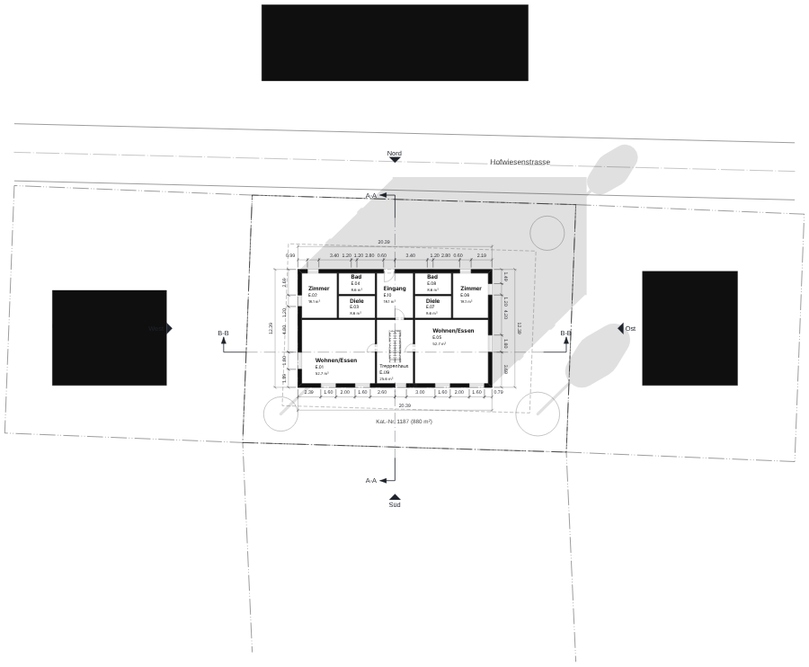
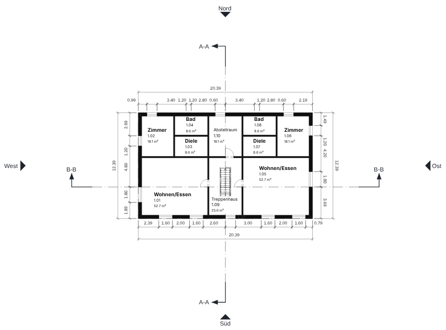
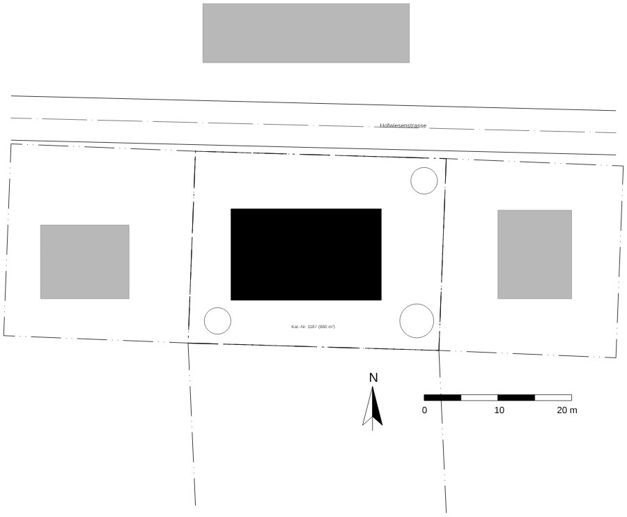
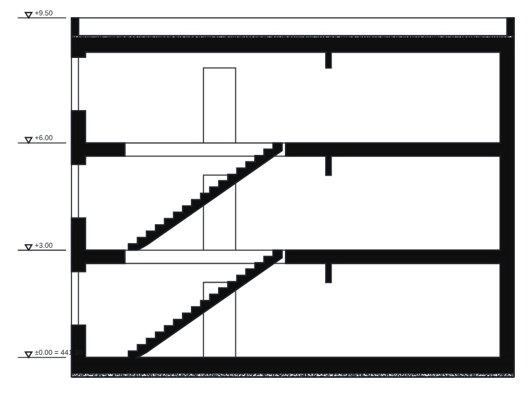
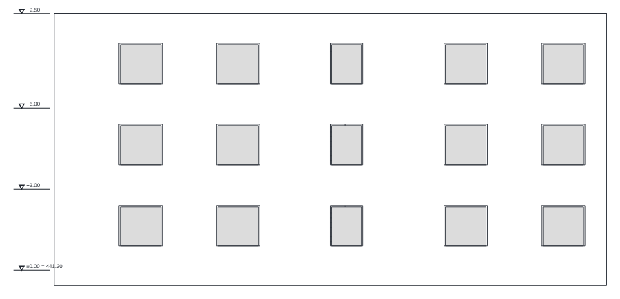

# Erster Wettbewerb mit Dossier

Kurzanleitung für die Version 1.0 „Wettbewerb & Vorprojekt“. Sie folgt dem Referenz-Ablauf aus `TODO.md` und
`doc/RELEASE-1.0.md` vom leeren Projekt bis zur Abgabe: Kataster laden, Baurecht prüfen, Volumen bauen, Räume gegen das
Raumprogramm halten, Kennzahlen nach SIA 416 lesen, Pläne 1:200 und Schnitt ableiten, Axonometrie und Schatten
ansehen, den Präsentationsplan auf A1 legen und PDF, DXF und IFC ausgeben.

**Zum Mitlesen:** Das Beispielprojekt **Wettbewerb** hat alle Schritte schon gemacht. Öffnen über
*Datei → Neu aus Vorlage → Wettbewerb* (Browser-Menü: „Neu aus Vorlage: Wettbewerb“). Es ist ein Mehrfamilienhaus mit
6 Wohnungen auf einer fiktiven Parzelle in Winterthur (LV95), 3 Geschosse, Flachdach, 30 Räume mit Raumprogramm,
Schnitte A-A und B-B, Ansichten, Situation 1:500 und ein Präsentationsplan A1. Auf der Kommandozeile:
`node dist-cli/dossier-cli.mjs :wettbewerb kennzahlen`.

Die Menüpfade gelten für die macOS-App (Hauptplattform). Im Browser-Build steht eine kürzere Menüleiste oben („Datei“,
„Bearbeiten“, „Ansicht“, „Fenster“, „Hilfe“); sie heisst dort teils anders (Datei: „Neues Projekt“, „Projekt speichern“,
„Neu aus Vorlage: Wettbewerb“, „Exportieren: DXF“). Es fehlen *Bearbeiten → Kennzahlen und Raumprogramm …* (stattdessen
das Panel **Flächenbilanz**) und *Fenster → Standort importieren* (stattdessen die Schaltfläche **Standort importieren**
im Panel **Gelände**). Alle Tastenkürzel zeigt *Hilfe → Tastaturkürzel …*; dort stehen auch die Kürzel für die
Befehlszeile.

> **Stand der Bilder:** Sie stammen aus dem Linux-Container (CLI-Ausgabe, mit Schraffur, als SVG im Chromium
> aufgenommen). Gerenderte 3D-Bilder fehlen, weil es dort kein WebGPU/Metal gibt; die Axonometrie als 3D-Dokument kommt ohne aus. Die Mac-Ansicht (Metal) kann in Strichstärke
> und Schriftbild abweichen.

---

## 0. Befehle eingeben

Dossier hat unten eine **Befehlszeile**. Befehlsnamen oder Kürzel tippen, Enter. Danach fragt die Zeile nach Punkten:
Klick in den Plan oder Koordinaten tippen (`x,y`; relativ mit `r5,3`), Enter beendet den Befehl, Esc bricht ab.
Wichtige Kürzel: `w` (`wand`) Wand · `d` (`decke`) Decke · `rf` (`dach`) Dach · `rm` (`raum`) Raum ·
`schnittlinie` (`sectionline`) Schnitt · `ansichtslinie` (`viewline`) Ansicht · `ansichten` alle vier Seiten ·
`praesentation` Präsentationsplan · `bild3d` 3D-Bild. Eigene Kürzel: *Einstellungen → Tastenkürzel*.

Die Tab-Taste springt immer in die Befehlszeile. Zwischen den Ansichts-Reitern (Grundriss, Schnitt, 3D …) wechselst du mit
Ctrl+Tab (vorwärts) und Ctrl+Umschalt+Tab (rückwärts), auch auf dem Mac mit der Ctrl-Taste. In Dialogen bleibt Tab bei
deren Feldern.

## 1. Leeres Projekt

*Datei → Neu* (⌘N; im Browser „Neues Projekt“). Das neue Projekt hat Erdgeschoss, Obergeschoss, Schnitt A und Ansicht Süd. Gleich speichern:
*Datei → Speichern unter …* (⇧⌘S), z. B. `wettbewerb.obp`. Danach genügt ⌘S.

## 2. Kataster-DXF laden (LV95)

*Datei → Importieren …* (im Browser „DXF/DWG importieren…“) und die Kataster-Datei wählen. Im Dialog die Vorgaben lassen
(neue Zeichnungsebene, Landeskoordinaten) und **Importieren**. Der Projekt-Nullpunkt liegt dann auf einem runden
LV95-Punkt; die Statusleiste zeigt lokale und LV95-Koordinaten. Parzellen und Gebäude liegen auf der neuen
Zeichnungsebene (Panel **Zeichnungsebenen**). Mit „Auf Plan einpassen“ (⌘0, „Alles einpassen“) siehst du alles. Strassennamen (Text auf Klasse 11) stehen entlang der
Strassenachse, wenn in der Nähe eine Linie, Polylinie oder ein Bogen derselben Klasse und Ebene liegt; ohne Achse bleiben sie gerade.

Online lädt *Fenster → Standort importieren* (Browser: Panel **Gelände**) Gebäude, Gelände und Luftbild von swisstopo. Das ist im Container nicht
geprüft.

## 3. Baurecht

1. Parzellengrenze im Plan anklicken.
2. Panel **Gelände** → Abschnitt „Baurecht der Parzelle“ → **Parzelle aus Auswahl**. Es erscheint z. B.
   „Parzelle 880 m² · zulässig …“.
3. **Grenzabstand** setzen, bei Bedarf je Kante, **Baulinie aus Auswahl** für die Strassenseite.
4. **Gesamthöhe max.** eintragen, optional **Profilwinkel** und **Vorsprünge bis**. Mit „Hülle im 3D“ zeigt Dossier die
   zulässige Hülle durchscheinend; Verstösse sind rot.

Die Prüfung steht darunter („Gebäude innerhalb der zulässigen Fläche“, „Höhe 9.50 m ≤ 12.00 m“). Im Beispiel:
Abstände 4/4/5/4 m, 12 m Gesamthöhe, Parzelle 880 m².

## 4. Volumen: Wände, Decke, Dach

Zuerst das Geschoss wählen (Panel **Zeichnungsebenen**, „Erdgeschoss“; ⌘5/⌘6 wechseln das Geschoss).

- **Wände:** `w`, Ecken klicken oder als LV95 tippen, mit dem Startpunkt schliessen, Enter. In Bogenwänden folgen Fenster und Türen
  dem Bogen (ausser bei Schichteinzug), Rundbogen- und andere Formöffnungen schneiden ihre echte Form, auch im 3D-Live-Schnitt.
  Eine Öffnung, die in eine Decke ragt, endet an der Deckenunterkante.
- **Decke:** `d`, die vier Ecken, Enter. Die Decke bekommt den Deckentyp des Projekts.
- **Dach:** `rf`, zwei Ecken; vorgegeben ist ein Satteldach. Die Dachform lässt sich schon in der
  Befehlszeile wählen („Flachdach“ unter den Optionen). Nachträglich: Dach wählen, Panel **Objekt-Info** → Abschnitt „Dach“
  → **Dachform** „Flachdach“; dann erscheint **Attika Höhe (m)** (0 = keine Attika), wie im Beispiel. Die Dachform ist ein
  Auswahlfeld, kein Schalter.
- **Wände verbinden:** Zwei oder mehr Wände wählen, Cmd+J (Windows/Linux: Ctrl+J). Dossier schliesst Ecken (L-Stoss) und
  T-Stösse, auch bei Bogenwänden (Erker). Liegen die Enden zu weit auseinander, nennt ein Hinweis den Grund.
- Obergeschosse: Wände wählen, ⌘C, mit ⌘6 („Geschoss höher“) das Geschoss wechseln, ⌘V: Die Kopie liegt auf dem aktiven
  Geschoss an denselben Koordinaten. (⌘D „Duplizieren“ legt dagegen eine Kopie mit Versatz von 0.5 m auf demselben
  Geschoss an, nicht auf einem anderen.)

**Volumen → Bauteile:** Hast du die Volumenstudie als freien Körper gezeichnet (`koerper`, senkrechter Quader, Zylinder
oder Prisma), wandelt der Befehl `solidtoparts` („Körper in Bauteile umwandeln“, auch `koerperinbauteile`; im Panel
**Werkzeuge** in der Gruppe 3D neben „Körper verschneiden“) ihn um: Körper wählen (oder in ihn klicken), und es entstehen je
Geschoss Aussenwände, Decken zwischen den Geschossen und ein Flachdach; fehlende Geschosse legt Dossier obenauf an, der
Körper entfällt. Alles ist ein Undo-Schritt. Was nicht geht (verjüngte oder geneigte Körper, Kugel, Kegel, Verschneidungen,
Unterkante zwischen zwei Geschossen), lehnt der Befehl mit einer Meldung ab.

**Möbel und Sanitär: Objekte.** Das Panel **Objekte** (neben den Werkzeugen) enthält die 2D-Objektbibliothek: Sanitär, Küche,
Tische, Sitzen, Schlafen, Schränke, Aussenraum (Auto mit Parkfeld, Velo, Rollstuhl-Wendekreis). Objekt wählen, im Plan den
Einfügepunkt klicken (Befehl `libobj`); vor dem Klick dreht R das Objekt, M spiegelt es. Die Vorschau hängt am Cursor.
Statt zu klicken, kannst du ein Objekt auch aus der Palette auf die Zeichenfläche ziehen: R und M wirken unterwegs, der Fang greift
wie im Befehl, Loslassen setzt es; Loslassen über dem Panel oder Esc bricht ab. Ein gesetztes Objekt wählst du an und änderst es im Panel **Objekt-Info** (Abschnitt
„Objekt“): **Breite**, **Tiefe**, **Anzahl** und weitere Parameter; bei Esstischen mit Stühlen regelt
**Unordnung**, wie schief die Stühle stehen, **Neu würfeln** zieht eine neue Anordnung (gleiche Zahl = gleiche Stühle). Die Zeichnung
folgt dem Detailgrad der Ansicht (grob, mittel, fein). Möbel liegen auf der Klasse 22, Sanitär auf 23, Fahrzeuge und
Freiflächen auf 24 und lassen sich dort ausschalten; Möbel und Sanitär sparen den Bodenbelag aus. Im DXF-Export wird jedes
Objekt als Block mit Einfügung ausgegeben. Die Objekte sind nur 2D; im 3D und im IFC erscheinen sie nicht.

## 5. Räume und Raumprogramm

1. `rm`, ins Gebäude klicken: Dossier erkennt den Raum aus den Wänden. Name und Nummer im Panel **Objekt-Info**
   setzen.
2. Panel **Flächenbilanz** → **Raumprogramm importieren …**: CSV mit den Spalten
   `Raum;Fläche [m²];Anzahl;Flächenart;Gruppe` wählen, Spalten zuordnen, **Importieren**. Das Programm erscheint als
   Soll/Ist-Tabelle (grün = erfüllt, gelb = Abweichung, „fehlt“ = noch kein Raum).
3. **Räume generieren** legt aus dem Programm ein Blatt mit Raumrechtecken an, um das Programm zu schieben.

Im Beispiel sind alle 7 Programmzeilen erfüllt (Toleranz 10 %).

## 6. Flächen und Kennzahlen SIA 416

Das Panel **Flächenbilanz** zeigt die Kennzahlenleiste: GF, aGF, GV, AZ, ÜZ. Darunter der „Flächen- und
Kennzahlen-Nachweis“ (HNF, NNF, VF, FF, KF; IVHB-Ziffern) mit **CSV** und **PDF**. Das Menü
*Bearbeiten → Kennzahlen und Raumprogramm …* gibt dasselbe als Meldung. Beispielwerte aus dem Projekt „Wettbewerb“:
GF 745 m², GV 2’234 m³, AZ 0.75, ÜZ 0.28. Das GV (SIA 416) ist je Geschoss GF × Geschosshöhe plus der Dachraum unter
Steildach und Gauben bis Oberkante Dach; Dachvorsprünge zählen nicht (das Wettbewerbsprojekt hat ein Flachdach, also keinen Dachraum).

**Baurecht-Nachweis.** Die zulässigen Ziffern trägst du im Panel **Gelände** unter „Baurecht der Parzelle“ ein: **GFZ max.**,
**AZ max.**, **BMZ max.**, **ÜZ max.**, **GZ min.** und **Fassadenhöhe max.** (zusätzlich zu „Gesamthöhe max.“); leer heisst
keine Vorgabe. Im Panel **Flächenbilanz** steht darunter die Tabelle „Nachweis gegen das Baurecht“: je Zeile zulässig, Projekt,
Reserve oder Überschreitung und erfüllt; fehlt die Vorgabe, steht „—“. Darunter die „Grundlagen des Nachweises“. Die Tabelle
geht mit **CSV** und **PDF** hinaus und lässt sich als Blatt-Tabelle („Baurecht-Nachweis (AZ, ÜZ, Höhen)“) auf ein Layout legen.
Auf der Kommandozeile: `node dist-cli/dossier-cli.mjs :wettbewerb kennzahlen --nachweis`. Die Fassadenhöhe misst Dossier
über ±0.00 (Näherung), die Grünfläche gilt nur, wenn du sie eingibst. Die **Kostenschätzung grob** (eBKP-H, CHF/m³ GV oder CHF/m² GF) steht im
selben Panel und lässt sich als Tabelle auf ein Blatt legen.

## 7. Pläne 1:200

In der Kopfleiste den **Massstab** wählen (Papier-Massstab 1:N anwenden), z. B. 1:200 für den Wettbewerb und 1:100
für das Vorprojekt. Der Detailgrad („grob“, „mittel“, „fein“) passt Strichstärken und Schraffuren an.

Raumstempel suchen sich bei engen Räumen zuerst eine Lücke zwischen den Linien der Zeichnung (Gauben-Umriss, Achsen, Koten)
und schrumpfen erst dann (90 %, dann 80 %). Die gestrichelte Baulinie und die Parzellengrenze setzen vor Masszahlen aus,
statt durch sie zu laufen.

Die Situation 1:500 mit Schwarzplan kommt aus der Standard-Ansichtsvorlage „Situation WBW“ (Gebäude schwarz,
Nachbarn grau, Parzelle, Nordpfeil, Massstabsbalken):

## 8. Schnitt und Ansicht

`schnittlinie`, Start- und Endpunkt quer durchs Gebäude, Enter: Es entsteht eine neue Ebene „Schnitt B“ in der
Liste der Zeichnungsebenen; anklicken zeigt den Schnitt mit Wänden, Decken, Dach und Koten. „Schnitt A“ und „Ansicht
Süd“ aus dem leeren Projekt folgen dem Gebauten, bis du ihre Linien verschiebst. Die übrigen Ansichten entstehen in
einem Schritt mit *Ansicht → Ansichten aller Seiten erzeugen* (Befehl `ansichten`): Dossier legt um das Gebäude je eine
Linie für Nord, Ost, Süd und West an, parallel zu den Fassaden (auch bei einem gedrehten Haus; der Plan gilt oben als
Norden) und mit etwas Abstand. Eine Seite, für die es schon eine Ansicht gibt, bleibt unverändert; ein Undo nimmt alle neuen
Ansichten zurück. Einzelne Ansichten zeichnest du weiterhin mit `ansichtslinie`.

In Ansicht und Schnitt zieht Dossier eine kräftige Bodenlinie auf ±0.00; sie ragt beidseits etwas über das Gezeichnete hinaus
und gehört zur Klasse 02 Gelände (ausgeschaltet entfällt sie). Die automatischen Höhenkoten sind in Papiergrösse gesetzt
(2 mm Schrift), auch im Blatt. Fenster zeigen in der Ansicht 1:200 Rahmen, Flügel und Glas, auch mit der Vorlage „Wettbewerb 1:200“;
nur im Grundriss und im Schnitt sind sie dort bewusst vereinfacht (Linien). Passt eine Masszahl nicht ins Segment, rückt sie zur
Seite oder nach aussen aus, statt in der Wand zu stehen. Senkrechte Masszahlen lesen immer von unten nach oben.

**Erker und Bogenwände in Schnitt und Ansicht.** Fenster in Bogenwänden sitzen im Schnitt und in der Ansicht wie im 3D und im
Grundriss im Wandloch (vorher schräg daneben). Die Wand liegt dort auf Sehnen: Fenster, die sich über die Geschosse
überlappen, teilen sich eine gemeinsame, gerade Facette. Im Musterhaus komplex gibt das im Erker eine breite Facette über
drei Geschosse; wer ihn runder will, legt die Fenster übereinander. Der Deckenrand folgt dort der Sehne statt des Bogens.
Das Ergebnis ist nur im Linux-Container angesehen; ob die breite Facette so bleibt, ist offen.

**Fenster und Türen im Grundriss: symbolisch oder geschnitten.** Vorgabe ist „symbolisch“: jedes Fenster und jede Tür
erscheint mit dem üblichen Öffnungssymbol (Rahmen, Glas, Flügel, Aufschlag), auch wenn die Schnitthöhe es nicht trifft — das
Badfenster ab 1.10 m, das Oberlicht oder das Rundfenster in 1.8 m. Mit „geschnitten“ richtet sich der Grundriss nach der
Schnitthöhe: liegt die Öffnung darüber oder darunter, bleibt die Wand geschlossen und die Öffnung erscheint als Linie über
(strichpunktiert) bzw. unter Schnitt (gepunktet), auf der schwarzen 1:100-Wand hell. Einstellen: Fenster oder Tür wählen, T,
Feld „Im Grundriss“ (gilt für alle gewählten Öffnungen, ein Rückgängig-Schritt); für alle Öffnungen eines Typs unter
*Fenster → Ressourcen*, Reiter „Fenstertypen“ bzw. „Türtypen“; als Vorgabe im Reiter „Modelldarstellung“, Option
„Fenster/Türen im Grundriss“. Das Element geht vor dem Typ, der Typ vor der Modelldarstellung. Gilt gleich für Bildschirm,
SVG, PDF und DXF; die Bemassung bleibt gleich. Die helle Linie auf schwarzer Wand lässt sich abschalten: Option „Öffnungen über/unter
Schnitt hell auf schwarzer Wand“. Treppen zeigen im Grundriss die Bruchlinie über die Laufbreite in Papiergrösse. Die Höhenkoten
im Schnitt und in der Ansicht messen nur das eigene Gebäude, nicht höhere Nachbarn. Das Gesamtbild des 1:100-Plans ist noch nicht
abgeschlossen (Plan-Review läuft).

## 9. Axonometrie und Schatten

Kopfleiste **Axonometrie** öffnet einen Reiter „3D · Erdgeschoss“. Im Panel **Gelände** schaltest du **Schatten im
3D zeigen** ein (auch „Schatten im Grundriss zeigen“) und wählst Datum (Tagundnachtgleiche, Sommer-, Wintersonnenwende)
und Uhrzeit. Mit **Begehen** (Umschalt+F, Knopf in der 3D-Werkzeugleiste „Navigation“) gehst du in Augenhöhe durchs Modell: W/A/S/D
oder Pfeile gehen, Q/E runter und hoch, Umschalt schneller, Alt langsamer, mit gedrückter Maustaste umschauen. Die
aktuelle Ansicht legst du als Kamera ab („Kamera aus aktueller Ansicht anlegen“, Gruppe **Kameras** im Panel
**Ausschnitte**) und öffnest sie später wieder. Ein 3D-Bild in Abgabeauflösung (z. B. A3 bei 300 dpi) erzeugt *Ansicht → 3D-Bild exportieren …* (Befehl
`bild3d`); es lässt sich speichern oder ins Layout einsetzen.

**3D-Dokument (Vektor-Axonometrie).** *Ansicht → 3D-Dokument erstellen* macht aus der aktuellen 3D-Kamera (Parallelprojektion oder
Perspektive) eine Linienzeichnung mit verdeckten Kanten: sichtbare Kanten kräftig, Umriss stärker, Flächen nach ihrer Lage hellgrau.
Dossier legt dafür einen Ausschnitt und ein Blatt A3 an; die Zeichnung rechnet der Kern bei jeder Anzeige neu (Modelländerungen wirken)
und geht wie Schnitt und Ansicht ins PDF, SVG und DXF. Sie braucht keine Grafikkarte. Jeder Ausschnitt der 3D-Ansicht zeigt auf einem
Blatt dasselbe 3D-Dokument. Auf der Kommandozeile: `dossier-cli :wettbewerb axo --view southeast --scale 200 --out axo.svg`
(Blick von Südost, Südwest, Nordost, Nordwest: `--view southwest` usw.; `--projection military` für Militär 45°/45°,
`--projection military30` für 30°/60°; `--camera Name` für eine Kamera des Projekts; `--hidden` zeigt verdeckte Kanten gestrichelt).

**Wenn die Grafikkarte ausfällt.** Verliert die Grafikkarte das Gerät (z. B. nach dem Ruhezustand oder beim Wechsel der
Grafik), baut Dossier die Anzeige nach kurzen Pausen neu auf. Der Plan bleibt dabei bei der einfachen SVG-Darstellung und
flackert nicht; die 3D-Ansicht zeigt „3D-Engine nicht verfügbar“ mit einem Hinweis, wenn der Neuaufbau mehrmals scheitert
(dann Projekt speichern und die App neu starten). Nach einem gelungenen Neuaufbau bleiben Kamera, Standpunkt und Ziel erhalten, auch
im Begehen; nur ein unverändertes Preset wird neu eingepasst. Die Tasten des Begehens (G, W/A/S/D, Umschalt+F) wirken auch ohne
Grafikkarte. Auf dem Mac ist das nicht geprüft.

**Vorschau-Marke.** Noch nicht fertige Funktionen tragen die Marke „Vorschau“ (Tooltip: „Noch nicht fertig — Ergebnisse können abweichen“): Pathtracing, Rendering, Kamerafahrt mit Video und der Geist-Modus beim Begehen.

**Begehen mit Kollision.** Beim Begehen hält dich das Modell auf: Wände und Fensterglas sperren, du gleitest an ihnen
entlang. Türöffnungen sind frei. Treppen, Stufen und Kanten steigst du mit (bis 25 cm ohne Hindernis), der Boden folgt
Decken, Gelände und Dächern. Die Taste G oder der Knopf „Geist (Wände durchlaufen)“ schaltet die Kollision aus und
wieder ein; im Geist-Modus gehst du durch Wände und Böden. Esc beendet das Begehen.

**Kamerafahrt.** Hast du mindestens zwei Kameras, fährt der Knopf **Kamerafahrt** (Gruppe **Kameras** im Panel
**Ausschnitte**) im 3D-Viewport in Listenreihenfolge durch alle Kameras; die Kameras selbst bleiben unverändert. Esc oder
ein Klick bricht die Fahrt ab. **Video …** öffnet den Dialog „Kamerafahrt“: „Dauer je Abschnitt (s)“ (0,5 bis 60 Sekunden;
die Gesamtdauer steht darunter), „Fahrt“ als „Flüssig (Spline durch alle Kameras)“ oder „Geglättet (sanfter Halt an jeder
Kamera)“ und das „Format“ (WebM, MP4 nur, wenn die Grafikumgebung es aufnehmen kann). Die Auflösung ist die Grösse des
3D-Viewports. **Aufnehmen** zeichnet die Fahrt auf, danach „Video speichern …“ oder „Neu aufnehmen“; „Abspielen“ fährt ohne
Aufnahme, „Abbrechen“ stoppt. Im Stil Pathtracing zeigt die Fahrt nur Vorschau-Qualität.

*Hier fehlen die Bilder: Das 3D läuft nur mit WebGPU (Browser) oder Metal (Mac), nicht im Linux-Container.*

**Pathtracing-Vorschau:** In der Oberleiste öffnet **Darstellung** das Menü der Darstellungsarten, gegliedert in
„Linien“ (Drahtgitter, Kanten, Nur Konturen), „Flächen“ (Schattiert, Schattiert mit Kanten, Texturiert, Weiss) und
„Rendern“. Dort, als einziger Eintrag der Gruppe „Rendern“, steht „Pathtracing“ mit der Marke „Vorschau“. Der
Viewport rechnet dann Bild für Bild weiter und wird sauberer; ein Zähler „Pathtracing: n Samples · x/s“ läuft, bis
„(fertig)“ dasteht. Die Sonne der Sonnenstudie liefert Licht und Himmel; steht sie unter dem Horizont, wird es Nacht, und
in den Räumen brennt ein Raumlicht (unten links abschaltbar). Die Belichtung stellt Dossier selbst ein („Auto“); unten links
im 3D gibt es dazu einen Regler von −3 bis +3 Blenden. Steht die Kamera im Raum, holt Dossier das Tageslicht gezielt durch
die Fenster. Materialien und Bildkarten
folgen den Baustoffen der Bauteile. Für die Abgabe: *Ansicht → 3D-Bild exportieren …* mit **Samples je Pixel
(Pathtracing)**; das Bild rechnet mit Fortschrittsanzeige und lässt sich abbrechen. Mehr Samples = weniger Rauschen, dafür
längere Rechenzeit. Es bleibt eine Vorschau; Endbilder gehen über das Rendering.

**Rendering ohne Blender.** *Ansicht → Rendering …* (Befehl `rendering`, Marke „Vorschau“) rechnet ein fotorealistisches Bild der aktiven
3D-Ansicht mit dem in Dossier eingebauten Cycles, ohne dass Blender installiert sein muss. Unter „Renderer“ steht „Eingebaut (Cycles)“
als Vorgabe, wenn die App es mitbringt; sonst bleibt „Blender“ (installiertes Blender ab 3.6). Im Browser ist die Wahl ausgegraut
(„Nur in der Desktop-App“). Gewählt werden „Kamera“ („Aktuelle 3D-Ansicht“ oder eine gespeicherte Kamera, die ihre Sonnenzeit mitbringt),
„Bildgrösse“ (von „Vorschau, 960 × 540“ bis A2 bei 300 dpi), „Qualität“ („Vorschau (32 Samples)“, „Normal (128 Samples)“,
„Hoch (512 Samples)“), „Datum und Uhrzeit der Sonne“ sowie „Gelände und Umgebung (Kontext) zeigen“, „Entrauschen (OIDN)“ und die
„Belichtung (EV, 0 = automatisch)“. **Rendern** startet; der Balken zeigt „Rendern: Sample n von N“, die verstrichene Zeit und eine
Schätzung der Restzeit, **Rendering abbrechen** beendet den Lauf. Beim allerersten Start übersetzt Cycles auf dem Mac seine Rechenkerne
für die Grafikkarte, das kann einige Minuten dauern. Danach erscheint das Bild: „Bild speichern …“ als PNG oder „Ins Layout einsetzen“ auf
das gewählte Blatt (so kommt es auch ins Plakat). Scheitert der Lauf, steht der Grund im Dialog und als Meldung; die Arbeitsdateien im
Temp-Ordner räumt Dossier jedes Mal auf. Kommandozeile: `dossier-cli projekt.obp render --engine cycles --out bild.png`. Auf dem Mac (Metal)
ist das nicht geprüft.

## 10. Präsentationsplan

Panel **Mappe** → **Präsentationsplan erstellen** (oder Befehl `praesentation`). Im Dialog Geschosse, Ansichten und
Schnitte (beliebig viele) wählen, Papier **A1**, Massstab 1:200 (Vorgabe) und **Erstellen**. Dossier ordnet alles im gemeinsamen
Massstab, mit Titeln, Nordpfeil, Massstabsbalken und Schriftfeld. Das Beispiel enthält so ein Blatt (3 Grundrisse,
4 Ansichten, die Schnitte A-A und B-B). Die Ausschnitte folgen der Vorlage „Präsentation“.

**Plakat aus einem Schritt.** Ist als Papier eine Plakat-Vorlage gewählt, ordnet Dossier den Inhalt auf dem Spaltenraster an:
die Situation 1:500 zuerst oben links, dann Grundrisse, Ansichten und Schnitt im festen Massstab, dazu die Tabellen
„Kennzahlen (SIA 416)“ und „Baurecht-Nachweis“ und im Rahmen fürs 3D-Bild die Axonometrie Südost als 3D-Dokument (Vektorzeichnung
aus dem Modell, Massstab passend zum Rahmen). Hat das Projekt schon ein Bild auf einem Blatt (Rendering-Dialog „Ins Layout einsetzen“
oder Knopf „Bild“), steht dieses Bild im Rahmen; nur wenn beides fehlt, bleibt der Platzhalter „3D-Bild hier einsetzen“. Was aufs Plakat soll,
wählst du im Dialog im Abschnitt „Plakat-Inhalt“ (Situation 1:500, Kennzahlen, Baurecht-Nachweis, Rahmen fürs 3D-Bild; je abwählbar).
Reicht der Platz nicht, entsteht ein zweites Plakat (Plan 2/2); der Massstab wird nie verkleinert. Bleibt Platz übrig,
verteilt Dossier ihn gleichmässig als Weissraum zwischen den Zeilen; das 3D-Bild wird höchstens so gross wie der grösste Grundriss.

**Bemassung und Marken im Plakat.** Der Haken „Aussenbemassung der Grundrisse ergänzen (wo sie fehlt)“ (Vorgabe an) legt für jedes gezeigte
Geschoss ohne Masse die automatische Aussenbemassung an (derselbe Weg wie der Befehl `autodim`, Klasse 81, Auto-Bemassung);
schon vorhandene Ketten bleiben. Zeigt das Plakat Schnitte oder Ansichten, stehen deren Marken (Klasse 91, Schnittmarken) in den Grundrissen,
damit die Jury den Schnitt findet. Nordpfeil und Massstabsbalken der Situation stehen am Rahmenrand unter dem Plan, nicht
auf Parzelle oder Strasse. Neue Ansichtslinien (Befehl `viewline`) heissen nach der Himmelsrichtung („Ansicht Süd“; Plan oben = Norden). Das Schriftfeld des
Masters entfällt bei Plakat-Vorlagen, die Kopfzeile mit Kennwort und „Plan x/n“ genügt. Alle Schriften werden ins PDF
eingebettet, damit die Druckerei sie nicht ersetzen muss.

## 11. Abgabe: PDF, DXF, IFC

- **PDF:** Panel **Mappe** → **Publikationssatz anlegen**, die Blätter anhaken, **Publizieren**. Es entsteht ein PDF
  (mit PDF-Ebenen je Kategorie, wenn eingeschaltet), Index im Titelblock und im Dateinamen.
- **DXF:** Geschoss wählen, *Datei → Exportieren → DXF* (Browser: „Exportieren: DXF“). LV95, Layer je Kategorie.
- **IFC:** *Datei → Exportieren → IFC* (IFC4 mit Wänden, Decken, Räumen). Für Fachplaner:innen liegt die Geometrie lokal
  um den Projekt-Nullpunkt; die LV95-Lage steht als Georeferenz in der Datei (Versatz des Ursprungs, ±0.00 in m ü. M.).
  Räume tragen Nummer, Name, Fläche und die SIA-416-Kategorie, das Geschoss die Flächen und Rauminhalte; Raumhöhe und
  Raumkörper entsprechen der lichten Höhe des Raumbuchs (unter Dachschrägen mit mittlerer und kleinster Höhe). Jedes Bauteil
  liegt auf einer IFC-Ebene mit dem Namen seiner Klasse wie im DXF (z. B. 20_Wände). Die Option
  „Kontext mitgeben (Gelände, Nachbargebäude)“ im Export-Dialog (Vorgabe aus; Kommandozeile `--kontext`) legt das Gelände und
  die Kontext-Netze am Grundstück mit ab. Die Objektbibliothek (Möbel, Sanitär) kommt nicht ins IFC. Nicht in Archicad
  oder Revit geöffnet (auch die Ebenen nicht).

**Plakat: Hilfslinien und Bild-Zuschnitt.** Im Panel **Mappe** ein Layout anlegen, im Dialog „Neues Layout“ die
**Plakat-Vorlage (Wettbewerb)** wählen (A0/A1, hoch oder quer): Dossier legt ein Raster aus Hilfslinien, eine Kopfzeile mit
Kennwort-Feld und „Plan x/n“ sowie den Massstab unter jeden Viewport. Eigene **Hilfslinien** ziehst du aus dem Lineal auf
das Blatt (Doppelklick auf eine Linie löscht sie; das Panel „Hilfslinien“ hat Zahlenfelder). Sie gehören zum Masterlayout,
gelten für alle Blätter dieses Masters und erscheinen nur am Bildschirm, nicht im PDF. Beim Ziehen rasten Kanten und
Mitten ein (8 Pixel; **Alt** hält den Fang aus). Ein **Bild** (PNG/JPEG) setzt der Knopf „Bild“ auf das Blatt, oder im
3D-Bild-Dialog „Ins Layout einsetzen“. Verschieben, an der Ecke skalieren (Seitenverhältnis bleibt); **Zuschneiden**
(Knopf) zeigt Griffe am Ausschnitt, die Felder Links/Rechts/Oben/Unten geben den Zuschnitt, „Zuschnitt aufheben“ stellt
das Original wieder her. Unter 100 dpi warnt das Bild-HUD („niedrige Auflösung“).

**Freie Texte auf dem Blatt.** Im Layout setzt der Knopf „Text“ in der Blatt-Leiste eine „Textspalte“: Rahmen aufziehen, dann tippen.
Der Rahmen rastet am Papierrand, an den Hilfslinien des Masters und an den Kanten von Ansichten, Bildern und Tabellen ein.
Die Schrift richtet sich nach dem Blattformat (A2 5 mm, A1 7 mm, A0 10 mm statt 3.5 mm). Schrift, Grösse und Ausrichtung
(links, zentriert, rechts, „Blocksatz“) stellst du in der Leiste des Editors ein. Der Umbruch rechnet mit den echten
Schriftbreiten, PDF und Bildschirm stimmen auf etwa 1 mm überein. Der Text liegt auf einer Klasse und lässt sich dort ausschalten.
Im DXF steht er als MTEXT (Breite, Schrift, fett, kursiv, Ausrichtung), eine einzelne zentrierte oder rechte Zeile als TEXT.
Geöffnet in AutoCAD oder BricsCAD wurde das noch nicht; die CAD-Programme brechen nach eigenen Schriftmassen um.

**Anonyme Abgabe.** Im Panel **Mappe**, Abschnitt Publikation, „Wettbewerb (anonym)“ einschalten und das **Kennwort**
eintragen. Dann zeigen Plankopf und Dateinamen nur das Kennwort, und diese Ausgaben enthalten keinen Projekt-, Büro- oder
Bearbeiternamen: PDF (Titel = Kennwort; Autor, Programm und Datum neutral), Berichte (Fläche, Raumbuch, Kosten, Öffnungen,
Bauteile, Programm), IFC, DXF/DWG (Blattnamen „Blatt n“), STEP und das Rendering-Paket für Blender. „WBW-Abgabe anlegen“
fasst alle Plakate in einen Publikationssatz. Vor jedem Export einer anonymen Abgabe (PDF, SVG, DXF, IFC,
CSV, Berichte, 3D-Bild, Rendering, Video, Publikationssatz) prüft Dossier auch den Freitext: Raum-, Geschoss-, Ebenen-,
Block-, Layout- und Blattnamen, Textobjekte und Bild-Dateinamen. Gesucht werden Projektname und -nummer, Büro, Bearbeiter:in,
Adresse, der Projekt-Dateiname, die Begriffe aus „Weitere Angaben, die nicht vorkommen dürfen“ (Panel **Mappe**, neben dem
Kennwort) sowie E-Mail-Adressen und Telefonnummern. Bei Treffern öffnet sich der Dialog „Anonymität prüfen“: Er nennt je
Fundstelle den Bereich, das Element mit Feld (z. B. Material Wärmedämmung · Name), den Text und den Begriff. „Abbrechen“
exportiert nichts; erst umbenennen und neu exportieren, oder „Trotzdem exportieren“. Allgemeine Wörter wie Haus oder Wohnen
und blosse Zahlen zählen nicht. Auf der Kommandozeile bricht ein Export bei Treffern mit Exit-Code 3 ab; `--ignore-anonymity`
übergeht die Prüfung. Die Prüfung ersetzt die Durchsicht vor der Abgabe nicht, `dossier-cli convert` und der BCF-Export
prüfen nicht.

**Kataster-Schwarzplan.** Nach dem Kataster-Import (Schritt 2) stellst du die Ansicht auf die Ansichtsvorlage „Situation
WBW 1:500“ oder „Schwarzplan 1:500“ (*Fenster → Ressourcen*, Ansichtsvorlagen). Das eigene Gebäude erscheint als gefüllter
Umriss über alle Geschosse, die Kataster-Gebäude und Nachbarn als gefüllte Grundfläche (Situation: grau, Schwarzplan: alles
schwarz), dazu Parzelle, Strassen, Höhenlinien, Nordpfeil und Massstabsbalken. Die Füllung der Nachbargebäude kommt aus dem Stil
ihrer Klasse: Im Ebenen-Editor (Ebene anklicken) stellst du die „Füllung“ der Klasse ein; Höhenlinien enden am gefüllten
Nachbarn. Raster, Wände, Möbel, Text, Masse und
Schnittmarken sind aus. Kamera-Sichtkegel (Klasse 92) und Sonnenschatten (08) sind in den Standard-Vorlagen Präsentation,
Eingabe, Ausführung, Situation und Schwarzplan ausgeschaltet. Alle Teile liegen auf Klassen (83 Situation Gebäude, 84 Planzeichen) und lassen sich dort
ausschalten.

**Sichern und Wiederherstellen.** Schreibt Dossier eine Datei (Projekt oder Export, in der Tauri-App), geht das über eine
Zwischendatei; bei einem Fehler bleibt die vorhandene Datei heil, und eine rote Meldung nennt den Grund. Beim Projekt bleibt
die vorige Fassung als `.obp~` liegen. Hat ein Projekt ungespeicherte Änderungen, fragen Fenster schliessen, ⌘Q, Neu und
Öffnen mit „Ungespeicherte Änderungen“ nach (Speichern · Nicht speichern · Abbrechen). Alle 30 Sekunden legt Dossier eine
Kopie ab, zwei Stände; nach einem Absturz bietet der Start „Ungesicherte Arbeit gefunden“ die neueste lesbare an
(Wiederherstellen · Verwerfen · Später). Lässt sich eine Datei nicht öffnen, bietet Dossier ihre vorige Fassung an; bei
offener Datei holt *Datei → Vorige Fassung wiederherstellen …* sie ebenfalls. Sie ersetzt die Datei erst beim nächsten
Speichern. Meldet Dossier, dass die automatische Sicherung nicht geschrieben werden konnte, das Projekt von Hand speichern.

Zum Schluss ⌘S. Das Projekt (`.obp`) enthält Volumen, Räume, Baurecht, Raumprogramm, Blätter und Publikationssätze.

---

## Noch offen

Das Wettbewerbsplakat ist erst teilweise fertig ([208] in `TODO.md`: die Freitext-Prüfung deckt nur die Namen ab, die Dossier
kennt), das Rendering (*Ansicht → Rendering …*, eingebautes Cycles [215] oder Blender [211]) und der Pathtracer ([212]) sind auf dem Mac noch nicht
geprüft. Der Ablauf wurde im Browser-Build automatisch
geprüft (`e2e/release10.spec.ts`); der Durchlauf auf dem Mac steht noch aus (`doc/RELEASE-1.0.md`).
