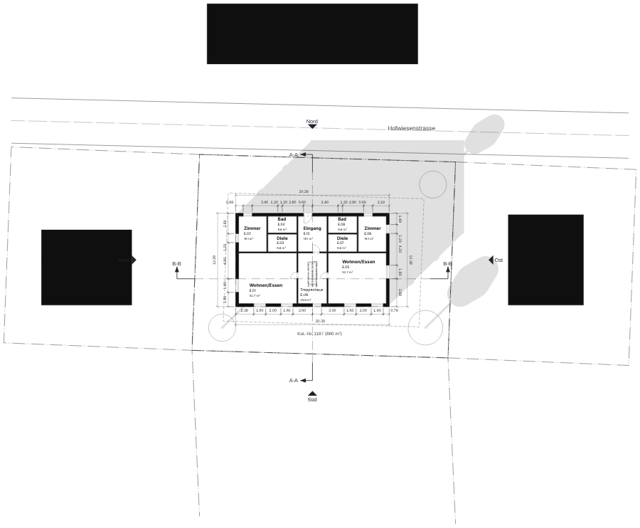
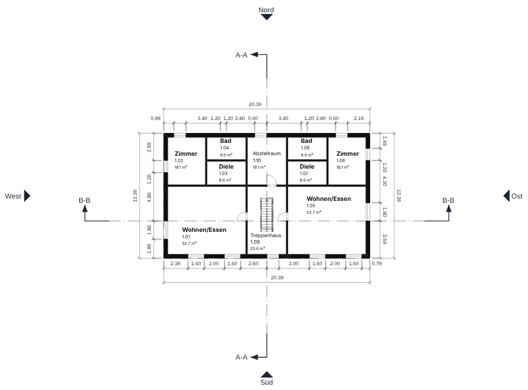
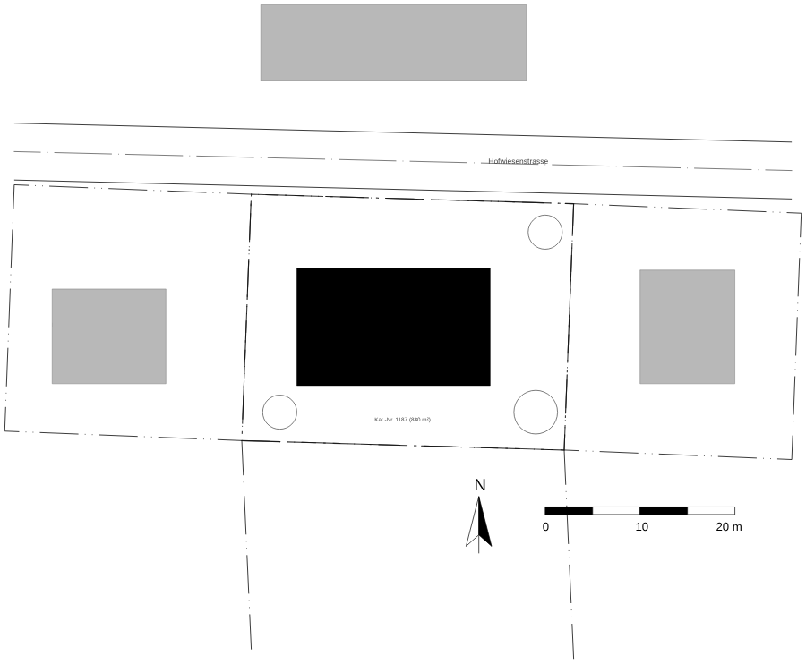
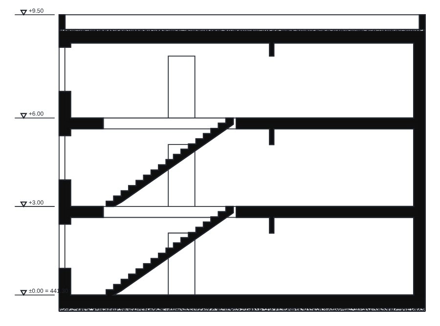
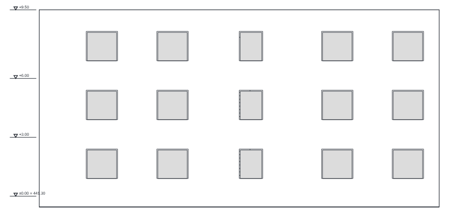

# Erster Wettbewerb mit Dossier

Kurzanleitung für die Version 1.0 „Wettbewerb & Vorprojekt“. Sie folgt dem Referenz-Ablauf aus `TODO.md` und
`doc/RELEASE-1.0.md` vom leeren Projekt bis zur Abgabe: Kataster laden, Baurecht prüfen, Volumen bauen, Räume gegen das
Raumprogramm halten, Kennzahlen nach SIA 416 lesen, Pläne 1:200 und Schnitt ableiten, Axonometrie und Schatten
ansehen, den Präsentationsplan auf A1 legen und PDF, DXF und IFC ausgeben.

**Zum Mitlesen:** Das Beispielprojekt **Wettbewerb** hat alle Schritte schon gemacht. Öffnen über
*Datei → Neu aus Vorlage → Wettbewerb* (Browser-Menü: „Neu aus Vorlage: Wettbewerb“). Es ist ein Mehrfamilienhaus mit
6 Wohnungen auf einer fiktiven Parzelle in Winterthur (LV95), 3 Geschosse, Flachdach, 30 Räume mit Raumprogramm,
Schnitte A-A und B-B, Ansichten, Situation 1:500 und ein Präsentationsplan A1. Auf der Kommandozeile:
`node dist-cli/dossier-cli.mjs :wettbewerb kennzahlen`.

Die Menüpfade gelten für die macOS-App (Hauptplattform). Im Browser-Build stehen dieselben Punkte in der Menüleiste
oben („Datei“, „Bearbeiten“, „Ansicht“, „Fenster“, „Hilfe“). Alle Tastenkürzel zeigt *Hilfe → Tastaturkürzel …*;
dort stehen auch die Kürzel für die Befehlszeile.

> **Stand der Bilder:** Sie stammen aus dem Linux-Container (CLI-Ausgabe, mit Schraffur, als SVG im Chromium
> aufgenommen). 3D-Bilder fehlen, weil es dort kein WebGPU/Metal gibt. Die Mac-Ansicht (Metal) kann in Strichstärke
> und Schriftbild abweichen.

---

## 0. Befehle eingeben

Dossier hat unten eine **Befehlszeile**. Befehlsnamen oder Kürzel tippen, Enter. Danach fragt die Zeile nach Punkten:
Klick in den Plan oder Koordinaten tippen (`x,y`; relativ mit `r5,3`), Enter beendet den Befehl, Esc bricht ab.
Wichtige Kürzel: `w` (`wand`) Wand · `d` (`decke`) Decke · `rf` (`dach`) Dach · `rm` (`raum`) Raum ·
`schnittlinie` (`sectionline`) Schnitt · `ansichtslinie` (`viewline`) Ansicht ·
`praesentation` Präsentationsplan · `bild3d` 3D-Bild. Eigene Kürzel: *Einstellungen → Tastenkürzel*.

## 1. Leeres Projekt

*Datei → Neu* (⌘N). Das neue Projekt hat Erdgeschoss, Obergeschoss, Schnitt A und Ansicht Süd. Gleich speichern:
*Datei → Speichern unter …* (⇧⌘S), z. B. `wettbewerb.obp`. Danach genügt ⌘S.

## 2. Kataster-DXF laden (LV95)

*Datei → Importieren …* (im Browser „DXF/DWG importieren…“) und die Kataster-Datei wählen. Im Dialog die Vorgaben lassen
(neue Zeichnungsebene, Landeskoordinaten) und **Importieren**. Der Projekt-Nullpunkt liegt dann auf einem runden
LV95-Punkt; die Statusleiste zeigt lokale und LV95-Koordinaten. Parzellen und Gebäude liegen auf der neuen
Zeichnungsebene (Panel **Zeichnungsebenen**). Mit „Auf Plan einpassen“ (⌘0, „Alles einpassen“) siehst du alles.

Online lädt *Fenster → Standort importieren* Gebäude, Gelände und Luftbild von swisstopo. Das ist im Container nicht
geprüft.

## 3. Baurecht

1. Parzellengrenze im Plan anklicken.
2. Panel **Gelände** → Abschnitt „Baurecht der Parzelle“ → **Parzelle aus Auswahl**. Es erscheint z. B.
   „Parzelle 880 m² · zulässig …“.
3. **Grenzabstand** setzen, bei Bedarf je Kante, **Baulinie aus Auswahl** für die Strassenseite.
4. **Gesamthöhe max.** eintragen, optional **Profilwinkel** und **Vorsprünge**. Mit „Hülle im 3D“ zeigt Dossier die
   zulässige Hülle durchscheinend; Verstösse sind rot.

Die Prüfung steht darunter („Gebäude innerhalb der zulässigen Fläche“, „Höhe 9.50 m ≤ 12.00 m“). Im Beispiel:
Abstände 4/4/5/4 m, 12 m Gesamthöhe, Parzelle 880 m².

## 4. Volumen: Wände, Decke, Dach

Zuerst das Geschoss wählen (Panel **Zeichnungsebenen**, „Erdgeschoss“; ⌘5/⌘6 wechseln das Geschoss).

- **Wände:** `w`, Ecken klicken oder als LV95 tippen, mit dem Startpunkt schliessen, Enter.
- **Decke:** `d`, die vier Ecken, Enter. Die Decke bekommt den Deckentyp des Projekts.
- **Dach:** `rf`, zwei Ecken; vorgegeben ist ein Satteldach. Ein Flachdach mit Attika stellst du in den
  Objekt-Informationen ein (Dachform „flach“), wie im Beispiel.
- Obergeschosse: Wände auf das nächste Geschoss kopieren (⌘D dupliziert die Auswahl) und mit ⌘6 das Geschoss
  wechseln.

Die Volumenstudie als freier Körper (`koerper`) wird noch nicht automatisch in Wände und Decken umgewandelt ([222]).

## 5. Räume und Raumprogramm

1. `rm`, ins Gebäude klicken: Dossier erkennt den Raum aus den Wänden. Name und Nummer in den Objekt-Informationen
   setzen.
2. Panel **Flächenbilanz** → **Raumprogramm importieren …**: CSV mit den Spalten
   `Raum;Fläche [m²];Anzahl;Flächenart;Gruppe` wählen, Spalten zuordnen, **Importieren**. Das Programm erscheint als
   Soll/Ist-Tabelle (grün = erfüllt, gelb = Abweichung, „fehlt“ = noch kein Raum).
3. **Räume generieren** legt aus dem Programm ein Blatt mit Raumrechtecken an, um das Programm zu schieben.

Im Beispiel sind alle 7 Programmzeilen erfüllt (Toleranz 10 %).

## 6. Flächen und Kennzahlen SIA 416

Das Panel **Flächenbilanz** zeigt die Kennzahlenleiste: GF, aGF, GV, AZ, ÜZ. Darunter der „Flächen- und
Kennzahlen-Nachweis“ (HNF, NNF, VF, FF, KF; IVHB-Ziffern) mit **CSV** und **PDF**. Das Menü
*Bearbeiten → Kennzahlen und Raumprogramm …* gibt dasselbe als Meldung. Beispielwerte aus dem Projekt „Wettbewerb“:
GF 745 m², GV 2’234 m³, AZ 0.75, ÜZ 0.28. Die **Kostenschätzung grob** (eBKP-H, CHF/m³ GV oder CHF/m² GF) steht im
selben Panel und lässt sich als Tabelle auf ein Blatt legen.

## 7. Pläne 1:200

In der Kopfleiste den **Massstab** wählen (Papier-Massstab 1:N anwenden), z. B. 1:200 für den Wettbewerb und 1:100
für das Vorprojekt. Der Detailgrad („grob“, „mittel“, „fein“) passt Strichstärken und Schraffuren an.

Die Situation 1:500 mit Schwarzplan kommt aus der Standard-Ansichtsvorlage „Situation WBW“ (Gebäude schwarz,
Nachbarn grau, Parzelle, Nordpfeil, Massstabsbalken):

## 8. Schnitt und Ansicht

`schnittlinie`, Start- und Endpunkt quer durchs Gebäude, Enter: Es entsteht eine neue Ebene „Schnitt B“ in der
Liste der Zeichnungsebenen; anklicken zeigt den Schnitt mit Wänden, Decken, Dach und Koten. „Schnitt A“ und „Ansicht
Süd“ aus dem leeren Projekt folgen dem Gebauten, bis du ihre Linien verschiebst. Weitere Ansichten mit
`ansichtslinie` (Nord, Ost, West).

## 9. Axonometrie und Schatten

Kopfleiste **Axonometrie** öffnet einen Reiter „3D · Erdgeschoss“. Im Panel **Gelände** schaltest du **Schatten im
3D zeigen** ein (auch „Schatten im Grundriss zeigen“) und wählst Datum (Tagundnachtgleiche, Sommer-, Wintersonnenwende)
und Uhrzeit. Ein 3D-Bild in Abgabeauflösung (z. B. A3 bei 300 dpi) erzeugt *Ansicht → 3D-Bild exportieren …* (Befehl
`bild3d`); es lässt sich speichern oder ins Layout einsetzen.

*Hier fehlen die Bilder: Das 3D läuft nur mit WebGPU (Browser) oder Metal (Mac), nicht im Linux-Container.*

## 10. Präsentationsplan

Panel **Mappe** → **Präsentationsplan erstellen** (oder Befehl `praesentation`). Im Dialog Geschosse, Ansichten und den
Schnitt wählen, Papier **A1**, Massstab 1:200 (Vorgabe) und **Erstellen**. Dossier ordnet alles im gemeinsamen
Massstab, mit Titeln, Nordpfeil, Massstabsbalken und Schriftfeld. Das Beispiel enthält so ein Blatt (3 Grundrisse,
4 Ansichten, Schnitt A-A). Die Ausschnitte folgen der Vorlage „Präsentation“.

## 11. Abgabe: PDF, DXF, IFC

- **PDF:** Panel **Mappe** → **Publikationssatz anlegen**, die Blätter anhaken, **Publizieren**. Es entsteht ein PDF
  (mit PDF-Ebenen je Kategorie, wenn eingeschaltet), Index im Titelblock und im Dateinamen.
- **DXF:** Geschoss wählen, *Datei → Exportieren → DXF* (Browser: „Exportieren: DXF“). LV95, Layer je Kategorie.
- **IFC:** *Datei → Exportieren → IFC* (IFC4 mit Wänden, Decken, Räumen).

Zum Schluss ⌘S. Das Projekt (`.obp`) enthält Volumen, Räume, Baurecht, Raumprogramm, Blätter und Publikationssätze.

---

## Noch offen

Das Wettbewerbsplakat A0/A1 mit Kennwort-Feld und anonymem PDF ist erst teilweise fertig ([208] in `TODO.md`), das
Rendering mit Blender (*Ansicht → Rendering mit Blender …*, [211]) ist auf dem Mac noch nicht geprüft, und die
Umwandlung eines Volumenkörpers in Wände und Decken fehlt ([222]). Der Ablauf wurde im Browser-Build automatisch
geprüft (`e2e/release10.spec.ts`); der Durchlauf auf dem Mac steht noch aus (`doc/RELEASE-1.0.md`).
