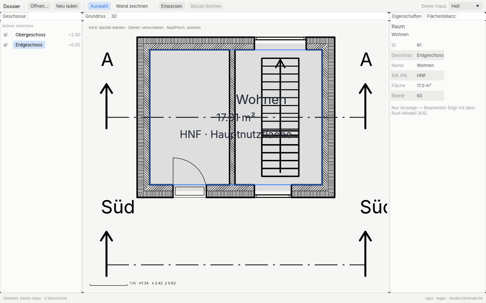
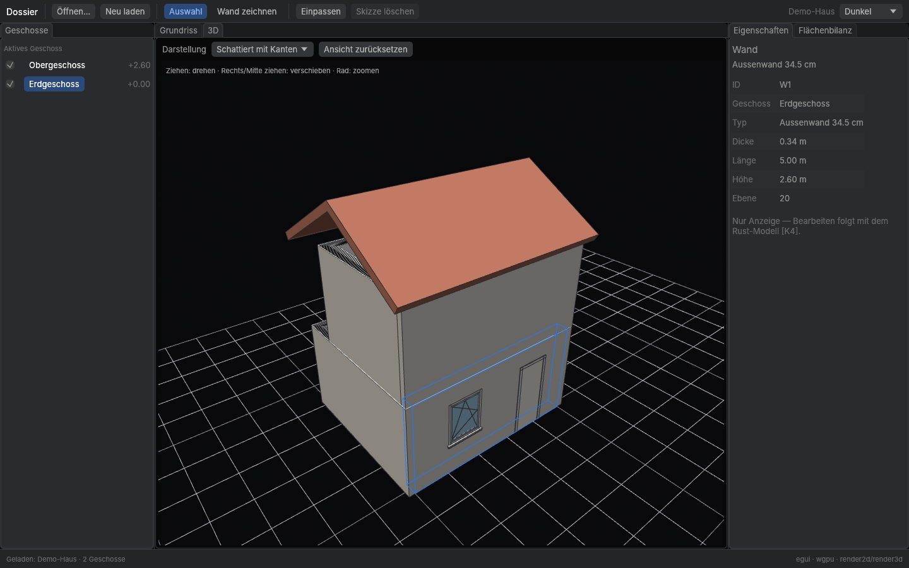
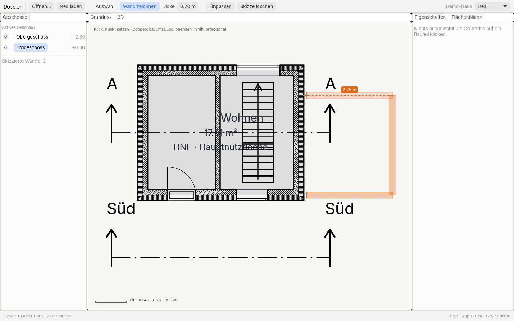

# dossier-egui — Dossier als native egui-App (Probe)

Eine alternative Oberfläche in Rust mit [egui](https://github.com/emilk/egui), damit man sehen und
anfassen kann, wie Dossier als native App daherkäme. Die TSX/Tauri-App bleibt unverändert; dieses
Crate ist **nicht** Teil von `npm run check` oder der CI (eigene, schwere Abhängigkeiten).





Weitere: `screenshots/3d-hell.png`. Alle im Linux-Container entstanden (s. „Prüfung").

## Bauen und starten

```sh
# 1. CLI bauen (einmal; braucht die WASM-Pakete in src/engine/pkg*)
npm run build:cli

# 2a. Demo-Haus: ohne Argument fragt die App die CLI selbst (`node dist-cli/dossier-cli.mjs :beispiel bundle`)
cd src-tauri/dossier-egui
cargo run --release

# 2b. Eigenes Projekt: Ansichtspaket erzeugen (im Repo-Wurzelverzeichnis) und öffnen
node dist-cli/dossier-cli.mjs projekt.obp bundle --out /tmp/projekt.bundle.json
cd src-tauri/dossier-egui && cargo run --release -p dossier-egui -- /tmp/projekt.bundle.json
# oder von überall: cargo run --release --manifest-path src-tauri/dossier-egui/Cargo.toml -- datei.json

# .obp direkt öffnen geht auch (per Kommandozeile oder „Öffnen…"), wenn `node` und
# dist-cli/dossier-cli.mjs gefunden werden (sonst DOSSIER_CLI=/pfad/zur/dossier-cli.mjs setzen).
cargo run --release -- ~/Projekte/haus.obp
```

Der erste Release-Build dauert einige Minuten (wgpu, winit, egui, glyphon). Das Crate hat einen
eigenen leeren `[workspace]` und ein eigenes `target/`.

Angenommen werden drei JSON-Arten (Erkennung am Inhalt):

| Datei | erzeugt mit | zeigt |
|---|---|---|
| Ansichtspaket | `dossier-cli projekt.obp bundle [--scale 100]` | alles: Geschosse, Grundriss je Geschoss, 3D je Geschoss, Bauteile, Kennzahlen, Raumprogramm |
| 3D-Modell | `dossier-cli projekt.obp model3d` | nur 3D (ein Pseudo-Geschoss) |
| Plan-Szene | `dossier-cli projekt.obp plan --format json [--level EG]` | nur Grundriss |

Weitere Optionen: `--theme light|dark|system`, `--lang de|en`, `--size 1440x900`, und für
Bildschirmfotos ohne Bedienung `--screenshot aus.png [--tab 3d] [--select <id>] [--sketch-demo]`
(speichert nach ein paar Bildern und beendet sich).

## Was es kann

- **Layout wie die TSX-App:** Werkzeugleiste oben, links *Geschosse*, Mitte *Grundriss | 3D*, rechts
  *Eigenschaften | Flächenbilanz*. Alle Tabs sind verschieb-/abdockbar (egui_dock).
- **Grundriss über render2d**, **3D über render3d** — dieselben Engines wie im Browser, hier nativ auf
  einem gemeinsamen wgpu-Device mit egui (Metal auf dem Mac). Die Engines rendern in Offscreen-Texturen,
  egui zeigt sie ohne CPU-Kopie. Neu gerendert wird nur bei Änderung (Pan/Zoom, Grösse, Modell).
  - Grundriss: Ziehen = verschieben, Rad/Pinch = zoomen um den Cursor, Massstabsleiste, Koordinaten.
  - 3D: Ziehen = drehen, rechts/Mitte ziehen = verschieben, Rad = Abstand; Stile Schattiert (mit
    Kanten), Weissmodell, Verdeckte Kanten; Bodenraster; Auswahl als blaue Kanten.
- **Geschosse:** aktives Geschoss für den Grundriss, Häkchen = im 3D sichtbar (je Geschoss eigenes
  3D-Modell im Paket), Umgebung separat.
- **Eigenschaften** des angeklickten Bauteils (Wand, Tür, Fenster, Raum, Stütze, Treppe, Decke, Dach)
  — nur Anzeige.
- **Flächenbilanz:** GF/aGF/bebaute Fläche/GV/AZ/ÜZ, je Geschoss, Raumprogramm Soll/Ist (aus
  `computeKennzahlen`/`checkRoomProgram`).
- **Werkzeug „Wand zeichnen"** als Interaktionsprobe: Klicks setzen Punkte (5-cm-Raster, Shift =
  orthogonal), Vorschau mit Länge, Doppelklick/Enter/Esc/Rechtsklick beendet. Die Wände erscheinen
  sofort auch im 3D, sind anwählbar, werden aber **nicht gespeichert**.
- Hell/Dunkel folgt dem System (umschaltbar; der Grundriss bleibt ein helles, im Dunkeln leicht
  gedimmtes Blatt, das 3D-Bodenraster erscheint nur hell, weil render3d feste Rasterfarben hat), Systemschrift (macOS: SF Pro/Helvetica Neue über fontdb,
  sonst Inter/Noto/DejaVu), Deutsch/Englisch über eine kleine eigene Tabelle (`src/i18n.rs`).

## Was es nicht kann

- **Nichts bearbeiten oder speichern.** Das Modell lebt noch in TS; die App sieht nur abgeleitete
  Daten (Szene, Netze, vereinfachte Bauteilformen). Echte Bearbeitung braucht [K4] (Modell + Ops in Rust).
- Kein Schnitt/Ansicht, keine Layouts/Pläne, keine Ebenen-/Kategorie-Steuerung, kein Picking im 3D,
  keine Bemassungs-/Fangfunktionen ausser Raster, kein Undo, Layout wird nicht gespeichert.
- Neu laden erzeugt das Paket komplett neu (kein inkrementelles Aktualisieren).

## Aufbau

| Datei | Inhalt |
|---|---|
| `src/main.rs` | Argumente, eframe-Start (wgpu, Geräte-Grenzen des Adapters) |
| `src/app.rs` | Zustand, Werkzeugleiste, Dock-Layout, Screenshot-Modus |
| `src/plan_view.rs` | Grundriss: render2d → Textur, Pan/Zoom, Auswahl, Wandwerkzeug, Overlays |
| `src/view3d.rs` | 3D: render3d → Textur, Orbit, Stile, Auswahl-Kanten, Skizzenwände |
| `src/offscreen.rs` | Offscreen-Ziel auf dem egui-Device (Farbraum-Trick für render2d) |
| `src/panels.rs` | Geschosse, Eigenschaften, Flächenbilanz |
| `src/bundle.rs` | JSON-Eingabe (Ansichtspaket, model3d, Plan-Szene) |
| `src/geom.rs` | Kamera-Abbildung, Treffertest, Fangen (GPU-frei, getestet) |
| `src/theme.rs`, `src/i18n.rs` | Erscheinungsbild, Texte |

Versionen: eframe/egui/egui-wgpu **0.35** + egui_dock **0.20** + wgpu **29**. egui 0.36/0.37 setzen
wgpu 30 voraus; render2d/render3d hängen über glyphon 0.11 an wgpu 29. Mit 0.35 teilen sich App und
Engines *ein* Device und die Engines zeichnen direkt in Texturen, die egui anzeigt. (Die Alternative —
eigenes wgpu-29-Device, Rückkopie über die CPU in eine egui-30-Textur — wäre bei jedem Bild ein
Readback; erst sinnvoll, wenn glyphon wgpu 30 kann, dann alles gemeinsam anheben.) Lizenzen der neuen
Abhängigkeiten: egui/eframe/egui-wgpu MIT OR Apache-2.0, egui_dock MIT, rfd MIT, fontdb/ttf-parser
MIT OR Apache-2.0, image MIT OR Apache-2.0. Kein Fremdcode übernommen.

## Prüfung

- `cargo test` (Kamera-Abbildung, Treffertest, Fangen, JSON-Lesen, Übersetzungstabelle); die CLI-Seite
  (`plan --format json`, `bundle`, `:beispiel`) prüft `src/cli/cli.test.ts` in `npm run check`.
- Gebaut und angesehen nur im **Linux-Container**: Xvfb + Vulkan über Mesa lavapipe (Software),
  Screenshots über `--screenshot`. Dafür nötig: `apt-get install libxkbcommon-x11-0 mesa-vulkan-drivers`,
  dann z. B. `xvfb-run -a -s "-screen 0 1600x1000x24" target/release/dossier-egui --theme light --select R1 --screenshot grundriss.png`.
  Bedient (Klicken, Ziehen, Tippen) wurde die App dort nicht — Auswahl und Wandvorschau in den Bildern
  sind über `--select`/`--sketch-demo` gesetzt. **Auf dem Mac (Metal, Retina, Trackpad, Systemschrift
  SF Pro, Dateidialog) nicht getestet.**

## Einschätzung: egui vs. heutige TSX-Oberfläche

**Aussehen auf macOS.** egui zeichnet alles selbst. Mit Systemschrift, ruhigen Farben und
Abständen wirkt es aufgeräumt und eher wie ein Werkzeug (Blender, Rerun) als wie eine Mac-App:
keine nativen Steuerelemente, keine Vibrancy/Seitenleisten-Materialien, Fokus-/Auswahlverhalten,
Kontextmenüs und Scrollverhalten sind eigenes egui-Verhalten. Die Fensterleiste ist nativ (winit),
ein echtes macOS-Menü gibt es nur mit Zusatzarbeit (muda o. ä.). Die TSX-App kommt mit CSS dem
Mac-Look heute näher und ist frei gestaltbar.

**Texteingabe/IME.** Einfache Felder gehen; IME (Umlaute per Dead Keys gehen, Kompositions-Eingaben
wie Japanisch) ist in egui/winit inzwischen da, aber weniger ausgereift als im WebView. Rich-Text
(Raumstempel, Textblöcke mit Formatierung) gibt es in egui nicht fertig — das wäre ein eigener
Editor. Im WebView hat Dossier das heute.

**Barrierefreiheit.** egui hat AccessKit (VoiceOver bekommt Rollen/Namen der Widgets), eingeschaltet.
Für eigene Zeichenflächen (Grundriss, 3D) muss man es selbst liefern — wie im Browser auch. Gesamt
schwächer als der WebView mit HTML-Semantik, aber nicht null.

**Leistung.** Ein Vorteil: Grundriss und 3D laufen ohne WebView-/WASM-Grenze direkt auf Metal, die
UI ist ein GPU-Pass, Start schnell, ein Prozess. Die heutige App hat dafür eigene Wege (render2d als
WASM-WebGPU, native Metal-Fläche unter dem WebView) — die egui-Variante macht das einfacher.

**Aufwand bis Gleichstand.** Gross. Die TSX-Oberfläche umfasst Dutzende Panels, Dialoge, Editoren
(Ressourcen, Layouts, Stifte, Rich-Text, Einstellungen-Fenster), Befehls-Zustandsautomaten,
Fang/Griffe, Druck-/PDF-Pfad (jsPDF + svg2pdf), i18n mit Prüfung. Grobe Schätzung: mehrere Monate
Vollzeit für Gleichstand, mit eigenen Lücken (Rich-Text, Druck/PDF, Plattform-Feinschliff).

**Abhängigkeit von [K4].** Ohne Modell und Ops in Rust bleibt egui ein Betrachter: jede Bearbeitung
müsste über die TS-CLI oder einen eingebetteten JS-Kern laufen. Sinnvoll entscheiden kann man erst,
wenn [K4] steht — dann ist eine egui-Oberfläche „nur noch" UI über einem Rust-Kern, und die Engines
sind schon nativ.

**Fazit (Vorschlag).** Für die Hauptoberfläche heute nicht umsteigen: TSX/Tauri bleibt beim Aussehen
auf dem Mac, Text und Aufwand vorne. egui ist aber ein guter Kandidat für (a) einen schnellen nativen
Betrachter/Prüfwerkzeug neben der App und (b) eine Neubewertung nach [K4]. Den Ausschlag sollte ein
Mac-Test dieser Probe geben (Gefühl von Schrift, Trackpad, Tempo).
